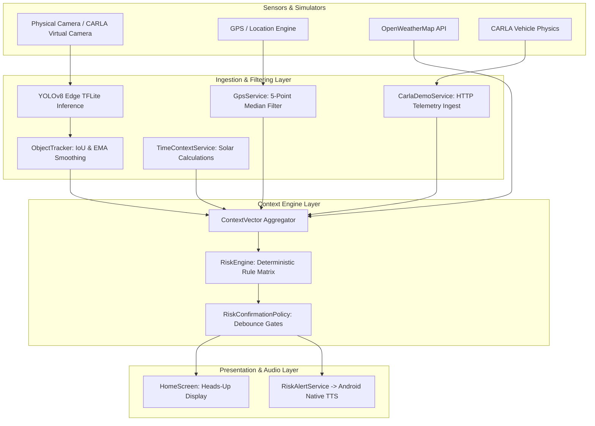
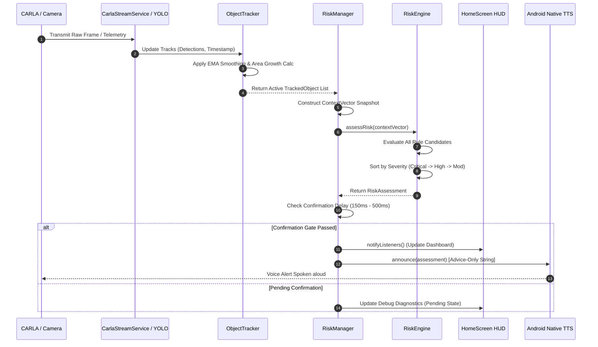

# CONTEXTDRIVE — COMPLETE CODEBASE STUDY HANDBOOK
## Comprehensive Architecture, Source Code, Algorithms, Flutter/Dart, CARLA, and Viva Defense Guide

> **Target Audience:** Engineering student preparing for B.Tech Computer Science project evaluation, seminar presentation, and final viva defense.  
> **System Scope:** Smartphone-based, context-aware Advanced Driver Assistance System (ADAS) prototype integrating on-device neural perception, temporal bounding-box tracking, environmental context fusion, deterministic multi-candidate risk assessment, and cyber-physical vehicle simulation via CARLA.  
> **Repository Root:** `C:\Users\chris\Documents\projects\ContextDrive`  
> **Target Document:** `docs/CONTEXTDRIVE_COMPLETE_STUDY_GUIDE.md`  

---

## TABLE OF CONTENTS

- [CHAPTER 1: THE CONTEXTDRIVE SYSTEM: PHILOSOPHY, SCOPE & ADAS FOUNDATIONS](#chapter-1-the-contextdrive-system-philosophy-scope--adas-foundations)
  - [1.1 Problem Statement & Real-World Motivation](#11-problem-statement--real-world-motivation)
  - [1.2 What "Context-Aware" Truly Means](#12-what-context-aware-truly-means)
  - [1.3 Why Deterministic Expert Rules Instead of Black-Box Risk Classifiers?](#13-why-deterministic-expert-rules-instead-of-black-box-risk-classifiers)
  - [1.4 Driver Assistance vs. Autonomous Driving (SAE Level Distinction)](#14-driver-assistance-vs-autonomous-driving-sae-level-distinction)
  - [1.5 System Boundaries, Non-Goals, and Honest Engineering Claims](#15-system-boundaries-non-goals-and-honest-engineering-claims)
  - [1.6 The Four Verification Tiers](#16-the-four-verification-tiers)
- [CHAPTER 2: END-TO-END SYSTEM ARCHITECTURE & MULTIMODAL DATA PATHS](#chapter-2-end-to-end-system-architecture--multimodal-data-paths)
  - [2.1 High-Level Architecture Block Diagram](#21-high-level-architecture-block-diagram)
  - [2.2 Camera Perception Pipeline](#22-camera-perception-pipeline)
  - [2.3 CARLA Simulation & Telemetry Pipeline](#23-carla-simulation--telemetry-pipeline)
  - [2.4 Physical Hardware Sensor Pipeline](#24-physical-hardware-sensor-pipeline)
  - [2.5 Multimodal Alert, Confirmation, and Rate-Limiting Pipeline](#25-multimodal-alert-confirmation-and-rate-limiting-pipeline)
  - [2.6 System Data-Flow Diagram (Mermaid)](#26-system-data-flow-diagram-mermaid)
  - [2.7 End-to-End Execution Sequence Diagram (Mermaid)](#27-end-to-end-execution-sequence-diagram-mermaid)
- [CHAPTER 3: FLUTTER & DART FOR JAVA AND PYTHON ENGINEERS](#chapter-3-flutter--dart-for-java-and-python-engineers)
  - [3.1 Dart Language Fundamentals Taught Through ContextDrive Code](#31-dart-language-fundamentals-taught-through-contextdrive-code)
  - [3.2 Flutter Framework Mechanics Taught Through ContextDrive Code](#32-flutter-framework-mechanics-taught-through-contextdrive-code)
  - [3.3 Flutter Execution Lifecycle & Tooling Mechanics](#33-flutter-execution-lifecycle--tooling-mechanics)
- [CHAPTER 4: REPOSITORY INVENTORY & VIVA LEARNING PRIORITY MATRIX](#chapter-4-repository-inventory--viva-learning-priority-matrix)
  - [4.1 Inventory Classification Methodology](#41-inventory-classification-methodology)
  - [4.2 Priority A Files (Must Understand Thoroughly)](#42-priority-a-files-must-understand-thoroughly)
  - [4.3 Priority B Files (Should Understand)](#43-priority-b-files-should-understand)
  - [4.4 Priority C Files (Know Role and Purpose)](#44-priority-c-files-know-role-and-purpose)
- [CHAPTER 5: DEEP-DIVE FILE-BY-FILE SOURCE CODE BREAKDOWN](#chapter-5-deep-dive-file-by-file-source-code-breakdown)
  - [5.1 `app/lib/main.dart` — Dependency Injection & Application Root](#51-applibmaindart--dependency-injection--application-root)
  - [5.2 `app/lib/models/context_vector.dart` — State & Risk Domain Contracts](#52-applibmodelscontext_vectordart--state--risk-domain-contracts)
  - [5.3 `app/lib/models/tracked_object.dart` — Visual History & Approach Dynamics](#53-applibmodelstracked_objectdart--visual-history--approach-dynamics)
  - [5.4 `app/lib/managers/object_tracker.dart` — Temporal Object Tracking Engine](#54-applibmanagersobject_trackerdart--temporal-object-tracking-engine)
  - [5.5 `app/lib/engine/risk_engine.dart` — Deterministic Multi-Candidate Risk Engine](#55-applibenginerisk_enginedart--deterministic-multi-candidate-risk-engine)
  - [5.6 `app/lib/managers/risk_manager.dart` — Central State Orchestrator](#56-applibmanagersrisk_managerdart--central-state-orchestrator)
  - [5.7 `app/lib/services/carla_camera_stream_service.dart` — CDVF Binary Frame Receiver](#57-applibservicescarla_camera_stream_servicedart--cdvf-binary-frame-receiver)
  - [5.8 `app/lib/services/carla_demo_service.dart` — HTTP Telemetry Receiver & Watchdog](#58-applibservicescarla_demo_servicedart--http-telemetry-receiver--watchdog)
  - [5.9 `carla/manual_driving_rig.py` & `carla/motion_math.py` — CARLA Rig & Vector Math](#59-carlamanual_driving_rigpy--carlamotion_mathpy--carla-rig--vector-math)
  - [5.10 `app/lib/ui/home_screen.dart` — Heads-Up Display & Bounding Box Painter](#510-applibuihome_screendart--heads-up-display--bounding-box-painter)
  - [5.11 Supporting Services: GPS, IMU, Weather, Time, and Speed Limit](#511-supporting-services-gps-imu-weather-time-and-speed-limit)
  - [5.12 `app/lib/services/risk_alert_service.dart` & Android Native TTS](#512-applibservicesrisk_alert_servicedart--android-native-tts)
- [CHAPTER 6: SUBSYSTEM & MODULE REFERENCE MAP](#chapter-6-subsystem--module-reference-map)
- [CHAPTER 7: CORE ALGORITHMS & MATHEMATICAL PRINCIPLES](#chapter-7-core-algorithms--mathematical-principles)
  - [7.1 Bounding Box Area as an Image-Space Proximity Proxy](#71-bounding-box-area-as-an-image-space-proximity-proxy)
  - [7.2 Exponential Moving Average (EMA) Temporal Smoothing](#72-exponential-moving-average-ema-temporal-smoothing)
  - [7.3 Intersection-over-Union (IoU) & Plausible Approach Fallback Association](#73-intersection-over-union-iou--plausible-approach-fallback-association)
  - [7.4 Area Growth Rate & Closing Classification](#74-area-growth-rate--closing-classification)
  - [7.5 GNSS Telemetry Filtering & Outlier Gating](#75-gnss-telemetry-filtering--outlier-gating)
  - [7.6 World-to-Vehicle Directional Acceleration Projection](#76-world-to-vehicle-directional-acceleration-projection)
  - [7.7 Event-Specific Differential Confirmation Gates](#77-event-specific-differential-confirmation-gates)
  - [7.8 Multi-Candidate Risk Arbitration & Severity Ranking](#78-multi-candidate-risk-arbitration--severity-ranking)
  - [7.9 CDVF Binary Framing & TCP Chunk Stream Reassembly](#79-cdvf-binary-framing--tcp-chunk-stream-reassembly)
- [CHAPTER 8: SIX END-TO-END EXECUTION WALKTHROUGHS](#chapter-8-six-end-to-end-execution-walkthroughs)
  - [8.1 Walkthrough A: Virtual Camera Frame to On-Screen Bounding Box](#81-walkthrough-a-virtual-camera-frame-to-on-screen-bounding-box)
  - [8.2 Walkthrough B: Approaching Vehicle Triggers Developing Approach Warning](#82-walkthrough-b-approaching-vehicle-triggers-developing-approach-warning)
  - [8.3 Walkthrough C: Signed Longitudinal Deceleration (Hard Braking vs. Acceleration)](#83-walkthrough-c-signed-longitudinal-deceleration-hard-braking-vs-acceleration)
  - [8.4 Walkthrough D: Road Speed-Limit Violation & Equality Boundary Logic](#84-walkthrough-d-road-speed-limit-violation--equality-boundary-logic)
  - [8.5 Walkthrough E: Compound Hazard Escalation in Adverse Weather](#85-walkthrough-e-compound-hazard-escalation-in-adverse-weather)
  - [8.6 Walkthrough F: Network Timeout, Stale Telemetry, and Sensor Blackout](#86-walkthrough-f-network-timeout-stale-telemetry-and-sensor-blackout)
- [CHAPTER 9: THE VERIFICATION SUITE: AUTOMATED TESTS & EMPIRICAL ANALYSIS](#chapter-9-the-verification-suite-automated-tests--empirical-analysis)
  - [9.1 Test Inventory (All 43 Automated Flutter Tests)](#91-test-inventory-all-43-automated-flutter-tests)
  - [9.2 What the Automated Tests Prove vs. What They Do Not Prove](#92-what-the-automated-tests-prove-vs-what-they-do-not-prove)
  - [9.3 How to Run and Verify the Test Suite](#93-how-to-run-and-verify-the-test-suite)
  - [9.4 Protocol for Empirical Latency & Lead-Time Measurement](#94-protocol-for-empirical-latency--lead-time-measurement)
- [CHAPTER 10: GUIDED CODE-READING & VIVA DEFENSE EXERCISES](#chapter-10-guided-code-reading--viva-defense-exercises)
  - [10.1 Twelve Step-by-Step Code-Reading Exercises](#101-twelve-step-by-step-code-reading-exercises)
  - [10.2 Verbal Defense Script: How to Explain Code Out Loud](#102-verbal-defense-script-how-to-explain-code-out-loud)
- [CHAPTER 11: COMPREHENSIVE VIVA QUESTION BANK (100+ QUESTIONS)](#chapter-11-comprehensive-viva-question-bank-100-questions)
  - [Topic 1: System Objectives & Engineering Scope](#topic-1-system-objectives--engineering-scope)
  - [Topic 2: Flutter, Dart, & State Management Mechanics](#topic-2-flutter-dart--state-management-mechanics)
  - [Topic 3: Computer Vision & Edge YOLO Inference](#topic-3-computer-vision--edge-yolo-inference)
  - [Topic 4: Object Tracking Mathematics (EMA, IoU, Area Growth)](#topic-4-object-tracking-mathematics-ema-iou-area-growth)
  - [Topic 5: CARLA Simulator Integration & Binary CDVF Protocol](#topic-5-carla-simulator-integration--binary-cdvf-protocol)
  - [Topic 6: Vehicle Motion Physics & Acceleration Projection](#topic-6-vehicle-motion-physics--acceleration-projection)
  - [Topic 7: GPS Filtering & Environmental Context Fusion](#topic-7-gps-filtering--environmental-context-fusion)
  - [Topic 8: Deterministic Risk Engine & Multi-Candidate Arbitration](#topic-8-deterministic-risk-engine--multi-candidate-arbitration)
  - [Topic 9: Alert Dispatch, Voice TTS, & Rate-Limiting](#topic-9-alert-dispatch-voice-tts--rate-limiting)
  - [Topic 10: Test Suite Coverage, Empirical Boundaries, & Critical Self-Appraisal](#topic-10-test-suite-coverage-empirical-boundaries--critical-self-appraisal)
- [CHAPTER 12: TECHNICAL GLOSSARY & QUICK-REFERENCE CHEAT SHEETS](#chapter-12-technical-glossary--quick-reference-cheat-sheets)
  - [12.1 Technical Glossary (60+ Terms Defined)](#121-technical-glossary-60-terms-defined)
  - [12.2 The 20 Most Critical Methods in ContextDrive](#122-the-20-most-critical-methods-in-contextdrive)
  - [12.3 The 20 Most Critical Constants, Thresholds, and Limits](#123-the-20-most-critical-constants-thresholds-and-limits)
  - [12.4 The 15 Most Important Source Files](#124-the-15-most-important-source-files)
  - [12.5 One-Page Architecture Summary for Memorization](#125-one-page-architecture-summary-for-memorization)
  - [12.6 Dart vs. Java/Python Syntax Cheat Sheet](#126-dart-vs-javapython-syntax-cheat-sheet)

---

# CHAPTER 1: THE CONTEXTDRIVE SYSTEM: PHILOSOPHY, SCOPE & ADAS FOUNDATIONS

### 1.1 Problem Statement & Real-World Motivation
Road traffic accidents remain one of the leading causes of preventable fatalities globally, with driver inattention, delayed response to sudden braking, tailgating, and driving at speeds inappropriate for weather conditions cited as dominant contributing factors. While modern premium automobiles incorporate high-end factory-fitted Advanced Driver Assistance Systems (ADAS) powered by automotive radar, LiDAR, and stereo cameras, hundreds of millions of existing vehicles in developing and emerging markets lack any active safety infrastructure.

The core motivation of **ContextDrive** is to investigate whether a ubiquitous, modern consumer smartphone (specifically evaluated on the Nothing Phone (2a) running Android 14 / MediaTek Dimensity 7200 Pro) can serve as an accessible, standalone ADAS platform. By mounting the smartphone on the windshield or dashboard, the system repurposes the device's internal camera, GNSS receiver, network connectivity, and edge Neural Processing Unit (NPU) / GPU to continuously monitor forward roadway conditions and alert the driver to imminent hazards.

### 1.2 What "Context-Aware" Truly Means
In traditional computer vision demos, an application simply draws bounding boxes around detected vehicles on a screen. However, **detecting an object is not equivalent to assessing driving risk**. 

Consider the following critical driving scenarios:
1. **Stationary Traffic Jam:** A lead vehicle is 2 meters in front of the ego vehicle. Both vehicles are stationary ($0\text{ km/h}$). The visual bounding box of the lead vehicle is huge. An object detector without context would scream danger. In ContextDrive, because vehicle speed is zero and no closing motion is detected, the risk level remains **LOW**.
2. **Night Driving in Heavy Rain:** A lead vehicle is 30 meters ahead. In daylight, this distance represents a safe following gap. However, at night on wet tarmac, braking distances increase dramatically and tire-road friction is compromised. ContextDrive fuses OpenWeatherMap rainfall data and solar day/night calculations into the assessment, escalating closing maneuvers that would otherwise be classified as benign into elevated advisories or warnings.
3. **Hard Braking in Clear vs. Adverse Conditions:** Decelerating at $-4.0\text{ m/s}^2$ on dry asphalt is an abrupt stop (Moderate risk). Decelerating at $-4.0\text{ m/s}^2$ while a tracked vehicle is closing rapidly under heavy rain or darkness represents an extreme hazard (escalating immediately to **CRITICAL**).

**Context-awareness** in ContextDrive means that raw perceptual detections are synthesized with:
- **Ego-vehicle kinematics:** Speed and signed longitudinal acceleration/deceleration.
- **Visual dynamics:** Temporal bounding-box growth rate and tracking history.
- **Environmental conditions:** Ambient daylight, solar twilight, precipitation category, and estimated atmospheric visibility.
- **Regulatory constraints:** Configured and queried roadway speed limits.

### 1.3 Why Deterministic Expert Rules Instead of Black-Box Risk Classifiers?
A common question in engineering project vivas is:  
*"Why didn't you train an end-to-end Deep Neural Network (DNN) or an XGBoost classifier to predict risk levels directly from sensor data?"*

ContextDrive deliberately adopts a **deterministic, rule-based expert engine** (`RiskEngine`) over machine-learned risk classification for three foundational engineering reasons:
1. **Explainability and Auditable Diagnostics:** In safety-critical driver assistance, the system must explain *why* an alert was issued. A black-box classifier outputs a probability score (e.g., $P(\text{crash}) = 0.82$) without causal clarity. ContextDrive produces a structured `RiskAssessment` containing human-readable diagnostic fields: `whatHappened`, `whyExplanation`, `recommendation`, and concrete `evidenceReasons`.
2. **Deterministic Bounded Execution:** Machine learning models are susceptible to out-of-distribution hallucinations and unpredictable edge-case regressions. A deterministic rule engine guarantees that specific boundary conditions ($a_x \le -3.5\text{ m/s}^2$ combined with visual approach) *always* trigger the exact designated response in constant time ($\mathcal{O}(1)$ or $\mathcal{O}(R)$ where $R$ is the number of rules).
3. **Absence of Calibrated Labeled Real-World Crash Datasets:** Training a supervised risk classifier requires hundreds of thousands of hours of synchronized vehicle telemetry paired with verified collision and near-miss labels across diverse weather and lighting conditions. Fitting a model to small synthetic datasets produces uncalibrated, dangerously deceptive confidence scores.

### 1.4 Driver Assistance vs. Autonomous Driving (SAE Level Distinction)
It is critical to distinguish ContextDrive from autonomous driving systems:
- **Autonomous Driving (SAE Levels 3, 4, 5):** The system actively controls vehicle actuators (steering, throttle, brake) and assumes legal responsibility for driving under defined Operational Design Domains (ODDs).
- **Passive Driver Assistance / ADAS (SAE Level 0):** ContextDrive is purely an **advisory warning system**. It possesses zero mechanical connection to the vehicle's braking or steering systems. It issues non-intrusive heads-up visual cues and priority-throttled audio advice to enhance driver situational awareness. The human driver retains 100% control, vigilance, and liability at all times.

### 1.5 System Boundaries, Non-Goals, and Honest Engineering Claims
To maintain rigorous academic and engineering integrity during defense, the following boundaries must be stated clearly:
- **No Calibrated Collision Probability:** ContextDrive does not output a probabilistic crash forecast. A `CRITICAL` risk level does *not* assert that a collision will occur; it asserts that three independent observed risk factors and adverse environmental context simultaneously met configured thresholds.
- **Visual Proximity is Not Metric Distance:** A monocular smartphone camera without stereo disparity or LiDAR cannot calculate physical distance in meters without severe assumptions regarding target vehicle dimensions and road plane geometry. The system treats normalized bounding-box area strictly as an **image-space visual proximity proxy**.
- **No Directional Smartphone IMU Claims:** Without a rigid vehicle-chassis mount and an orientation calibration algorithm, a phone's internal 3-axis accelerometer measures phone-relative coordinate forces, not vehicle-forward acceleration. Consequently, physical IMU directional braking is marked as uncalibrated in the mobile client; directional longitudinal acceleration is authoritatively validated in the cyber-physical CARLA testbed via world-to-vehicle vector projection.

### 1.6 The Four Verification Tiers
Throughout this study guide and in any project examination, system capabilities are classified strictly into four verification tiers:
1. **Tier 1: Implemented in Code:** Fully written, functional Dart/Python classes, data structures, and algorithms residing in the active repository checkout.
2. **Tier 2: Verified by Automated Tests:** Logic explicitly proven by automated unit, widget, or contract tests (`flutter test`, passing all 43 test suites).
3. **Tier 3: Observed in Live Hardware/Simulation:** Capabilities verified end-to-end on physical hardware (Nothing Phone 2a connected via USB-C ADB reverse sockets) coupled to a live CARLA 0.9.16 simulation rig.
4. **Tier 4: Future Roadmap / Uncalibrated:** Concepts designed or discussed in documentation that require future road trials, stereo depth sensors, or fleet data calibration.

---

# CHAPTER 2: END-TO-END SYSTEM ARCHITECTURE & MULTIMODAL DATA PATHS

### 2.1 High-Level Architecture Block Diagram
ContextDrive is structured into four decoupled layers:
1. **Perception & Telemetry Ingestion Layer:** Hardware interfaces capturing camera frames, GNSS coordinates, and simulation packets.
2. **Normalization & Tracking Layer:** State estimators smoothing bounding boxes, tracking identities, rejecting GPS jitter, and estimating motion trends.
3. **Context Fusion & Risk Engine Layer:** The state aggregator (`ContextVector`) and deterministic evaluator (`RiskEngine`).
4. **Presentation & Actuation Layer:** The Flutter Heads-Up Display (HUD) and native Android Text-to-Speech (TTS) alert engine.

```
+-----------------------------------------------------------------------------------+
|                        PERCEPTION & INGESTION LAYER                               |
|  [Android Camera / CARLA Virtual Camera]   [GNSS / OpenWeatherMap / Overpass OSM] |
+-----------------------------------------------------------------------------------+
                                         |
                                         v
+-----------------------------------------------------------------------------------+
|                       TRACKING & NORMALIZATION LAYER                              |
|       [YOLOv8 Edge Inference]              [GpsService 5-Point Median Filter]     |
|                  |                                        |                       |
|       [ObjectTracker (EMA + IoU)]          [TimeContext Solar Twilight Calc]      |
+-----------------------------------------------------------------------------------+
                                         |
                                         v
+-----------------------------------------------------------------------------------+
|                       CONTEXT FUSION & RISK ENGINE LAYER                          |
|                                [ContextVector]                                    |
|                                        |                                          |
|            [RiskEngine: Deterministic Multi-Candidate Rule Arbitration]            |
+-----------------------------------------------------------------------------------+
                                         |
                                         v
+-----------------------------------------------------------------------------------+
|                       PRESENTATION & ACTUATION LAYER                              |
|      [Flutter HUD Interface]              [RiskAlertService + Native Android TTS] |
|   (Dynamic Status Card & Overlays)           (Advice-Only Spoken Speech Dispatch) |
+-----------------------------------------------------------------------------------+
```

### 2.2 Camera Perception Pipeline
The vision pipeline supports two mutually exclusive inputs:
- **Physical Phone Camera:** Managed via the `ultralytics_yolo` package and Google CameraX. Camera frames are streamed to an on-device TFLite neural model (`yolo26n_w8a32.tflite`).
- **CARLA Virtual Camera:** An RGB camera sensor attached to the ego-vehicle hood in CARLA (1280x720, 90° FOV, capped at 30 FPS) encodes frames into JPEG and transmits them over a high-throughput TCP socket using the custom binary **CDVF** (`ContextDrive Video Frame`) protocol.
- **Inference & Bounding Box Normalization:** Detections are clamped to $[0.0, 1.0]$ normalized coordinates by `_validNormalizedBox`.
- **Temporal Tracking:** Detections are ingested by `ObjectTracker.updateTracks()`. Bounding boxes are smoothed using an Exponential Moving Average ($\alpha = 0.45$). Overlap matching uses Intersection-over-Union (IoU $> 0.30$) with a scale-expansion fallback.
- **Dynamic Closing Classification:** Area growth over a minimum of 200 ms and 3 samples is evaluated by `TrackedObject._updateClosingRate()`.

### 2.3 CARLA Simulation & Telemetry Pipeline
When operating in simulated vehicle mode:
- A Python driving rig (`carla/manual_driving_rig.py`) controls a Tesla Model 3 ego vehicle.
- Vehicle physics (world-space velocity, transform, world-space acceleration) are sampled at 30 Hz.
- `carla/motion_math.py` projects acceleration onto the vehicle's direction of travel, computing **signed longitudinal acceleration** ($a_{\text{longitudinal}}$).
- Telemetry packets are serialized to JSON (schema v3.0) and sent via HTTP POST to the smartphone's embedded HTTP server (`CarlaDemoService`, port 8080) through an ADB reverse tunnel (`adb reverse tcp:8080 tcp:8080`).
- A watchdog timer flags stale or paused simulation clocks if no progression is detected for $> 1.0\text{ s}$.

### 2.4 Physical Hardware Sensor Pipeline
When operating in physical road vehicle mode:
- **GNSS Speed Filtering:** `GpsService` samples GPS at 1 Hz, checks horizontal accuracy ($\le 20\text{ m}$), speed accuracy ($\le 2.0\text{ m/s}$), sample latency ($\le 2\text{ s}$), rejects unphysical acceleration spikes ($> 10\text{ m/s}^2$), and applies a 5-sample median filter with stationary drift suppression ($< 3.0\text{ km/h} \to 0\text{ km/h}$).
- **External Meteorological Context:** `WeatherService` queries OpenWeatherMap REST API with 15-minute caching and 5-minute error retry throttling.
- **Astronomical Solar Calculations:** `TimeContextService` executes solar position math using `sunrise_sunset_calc` to determine true solar twilight ($\pm 30\text{ min}$) and night windows based on exact GPS coordinates.
- **Speed Limits:** `SpeedLimitService` queries OpenStreetMap tags via the Overpass API within a 30-meter radius of the ego coordinates, caching for 30 seconds.

### 2.5 Multimodal Alert, Confirmation, and Rate-Limiting Pipeline
1. `RiskEngine.assessRisk()` evaluates all rules and generates a list of `_Candidate` objects.
2. Candidates are sorted in descending order of severity (`Critical` $\to$ `High` $\to$ `Moderate` $\to$ `Low`).
3. The primary candidate is submitted to `RiskManager._applyAssessment()`.
4. **Differential Confirmation Gate:** The candidate is held in pending confirmation for a duration determined by `RiskConfirmationPolicy.delayFor()`:
   - Close optical approach during hard braking: **150 ms**
   - Adverse closing vehicle: **250 ms**
   - Developing visual approach: **350 ms**
   - Contextual weather / general rules: **500 ms**
5. Once confirmed, the alert updates the HUD. A 3-second downward cooldown prevents visual flicker.
6. If voice alerts are enabled, `RiskAlertService.announce()` is triggered. Audio warnings enforce a 6-second cooldown (High/Critical) or 12-second cooldown (Moderate). Higher severity preempts cooldown.
7. **Advice-Only Speech Generation:** In accordance with driver ergonomics, the system invokes the native Android TTS engine to speak **strictly the actionable advice string** (`assessment.recommendation`), suppressing verbose alert titles and explanations.

### 2.6 System Data-Flow Diagram (Mermaid)



### 2.7 End-to-End Execution Sequence Diagram (Mermaid)



---

# CHAPTER 3: FLUTTER & DART FOR JAVA AND PYTHON ENGINEERS

### 3.1 Dart Language Fundamentals Taught Through ContextDrive Code

Coming from Java and Python, Dart has immediate familiarities (C-style syntax, object orientation, garbage collection), but contains modern language features that are fundamental to understanding ContextDrive.

#### 1. Variables, `final`, `const`, and `late`
- In **Java**, you use `final` for immutable variables and `static final` for constants.
- In **Python**, constants are merely conventions (uppercase names).
- In **Dart**:
  - `var`: Type-inferred mutable variable.
  - `final`: Single-assignment variable initialized at runtime.
  - `const`: Compile-time constant (canonicalized in memory).
  - `late`: Deferred initialization variable; guarantees it will be initialized before access without requiring nullability.

*Real ContextDrive Example from `app/lib/services/carla_camera_stream_service.dart`:*
```dart
static const int defaultPort = 8088;
static const List<int> magicBytes = [0x43, 0x44, 0x56, 0x46]; // "CDVF"
final BytesBuilder _buffer = BytesBuilder(copy: false);
```
**Explanation:** `defaultPort` and `magicBytes` are compile-time immutable memory allocations (`const`). `_buffer` is a runtime instance created once (`final`), but its internal state is mutable.

#### 2. Sound Null Safety: `?`, `!`, `??`, and `??=`
Dart features sound null safety. Types are non-nullable by default.
- `Type?`: The variable can either hold an instance of `Type` or `null`.
- `expr!`: The null-assertion operator. Tells the compiler: *"I guarantee this is not null at runtime; throw a runtime error if it is."*
- `expr1 ?? expr2`: If-null operator. Evaluates to `expr1` unless it is null, in which case it returns `expr2`. (Equivalent to `expr1 if expr1 is not None else expr2` in Python).
- `expr1 ??= expr2`: Assigns `expr2` to `expr1` only if `expr1` is currently null.

*Real ContextDrive Example from `app/lib/managers/risk_manager.dart`:*
```dart
int get configuredSpeedLimit => overrideSpeedLimit ?? _configuredSpeedLimit;
```
**Explanation:** If the developer has set an `overrideSpeedLimit` in the debug sheet, that value is used; otherwise, it falls back to the default `_configuredSpeedLimit` (60 km/h).

#### 3. Modern Dart Records: `({Type field1, Type field2})`
Dart 3 introduced **Records**—strongly typed, anonymous, immutable aggregate values. In Java, you would have to write a verbose `class` or `record`; in Python, you might use a `tuple` or `namedtuple`.

*Real ContextDrive Example from `app/lib/models/tracked_object.dart`:*
```dart
final List<({DateTime time, double area})> areaHistory = [];
```
**Explanation:** `areaHistory` is a list of anonymous record structs holding a `time` and an `area`. This avoids the boilerplate of creating a separate class just to store two measurement values.

#### 4. Switch Expressions and Pattern Matching
Dart 3 features concise, exhaustive pattern-matching expressions.

*Real ContextDrive Example from `app/lib/managers/risk_manager.dart`:*
```dart
double _visualProxy(ProximityCategory proximity) => switch (proximity) {
  ProximityCategory.veryNear => 0.1,
  ProximityCategory.near => 0.3,
  ProximityCategory.medium => 0.6,
  ProximityCategory.far || ProximityCategory.unknown => 1.0,
};
```
**Explanation:** This expression maps enum values directly to numeric proxies. The `||` pattern matches both `far` and `unknown`. The compiler guarantees exhaustiveness; if a new enum value is added, compilation fails until it is handled.

#### 5. Asynchronous Programming: `Future`, `async`/`await`, and `Stream`
- **`Future<T>`:** Represents a potential value or error that will be available at some point in the future. (Equivalent to `CompletableFuture<T>` in Java, or `asyncio.Future` in Python).
- **`Stream<T>`:** Represents a sequence of asynchronous events over time. (Equivalent to a reactive `Flow` / `Observable` in Java, or an `async generator` in Python).

*Real ContextDrive Example from `app/lib/managers/risk_manager.dart`:*
```dart
_positionSubscription = _gpsService.getPositionStream().listen(_onPosition);
```
**Explanation:** `getPositionStream()` yields location updates as satellites fix coordinates. `.listen()` registers an event listener callback (`_onPosition`) and returns a `StreamSubscription`, which is retained so it can be canceled when the manager is disposed.

---

### 3.2 Flutter Framework Mechanics Taught Through ContextDrive Code

#### 1. The Declarative Widget Tree
In Android Java (XML + `findViewById`), you construct views imperatively and mutate their properties (`textView.setText(...)`). In Flutter, the UI is a **declarative function of state**:
$$\text{UI} = f(\text{State})$$
Whenever application state changes, Flutter rebuilds the widget subtree.

#### 2. `StatelessWidget` vs. `StatefulWidget`
- **`StatelessWidget`:** Immutable configuration. Does not manage internal state that changes across its lifecycle. Example: `ContextDriveApp` in `main.dart`.
- **`StatefulWidget`:** Maintains a companion `State` object that persists across widget rebuilds. Example: `HomeScreen` in `home_screen.dart`, which manages camera controllers and active lifecycle listeners.

#### 3. State Management with `Provider`
ContextDrive uses the **Provider** architectural pattern, which is built on Flutter's low-level `InheritedWidget`.
- **`ChangeNotifier`:** A Dart class that implements the Observer pattern. When its internal variables change, calling `notifyListeners()` instructs Flutter to rebuild all listening widgets.
- **`ChangeNotifierProvider<T>`:** Creates an instance of a `ChangeNotifier` and makes it available to all descendant widgets in the tree.
- **`context.read<T>()`:** Obtains a reference to type `T` *without* registering for rebuilds. Ideal inside button callbacks and lifecycle setup.
- **`context.watch<T>()` or `Consumer<T>`:** Obtains a reference to type `T` and *subscribes* to updates. When `notifyListeners()` fires, the widget automatically re-renders.

*Real ContextDrive Example from `app/lib/main.dart`:*
```dart
ChangeNotifierProxyProvider4<GpsService, WeatherService, TimeContextService, CarlaDemoService, RiskManager>(
  create: (ctx) => RiskManager(
    ctx.read<GpsService>(),
    ctx.read<WeatherService>(),
    ctx.read<TimeContextService>(),
    ctx.read<CarlaDemoService>(),
  ),
  update: (ctx, gps, weather, time, carla, previous) => 
      previous ?? RiskManager(gps, weather, time, carla),
),
```
**Explanation:** `ChangeNotifierProxyProvider4` injects four independent dependencies into `RiskManager` while ensuring `RiskManager` remains a single, shared lifecycle singleton accessible to the entire UI.

#### 4. Custom Painting with `CustomPainter` and `Canvas`
When rendering visual bounding boxes over video frames, Flutter does not instantiate expensive separate widget trees for every rectangle. Instead, it utilizes `CustomPaint` and `CustomPainter`, issuing low-level 2D graphics draw commands directly to the GPU via Skia / Impeller.

*Real ContextDrive Example from `app/lib/ui/home_screen.dart`:*
```dart
class BoundingBoxPainter extends CustomPainter {
  final List<DetectedObject> detections;
  final Size sourceSize;

  BoundingBoxPainter({required this.detections, required this.sourceSize});

  @override
  void paint(Canvas canvas, Size size) {
    if (detections.isEmpty || sourceSize.isEmpty) return;

    final boxPaint = Paint()
      ..color = const Color(0xFF00FF88)
      ..style = PaintingStyle.stroke
      ..strokeWidth = 2.5;

    // Coordinate transformation matching Image.memory(fit: BoxFit.cover)
    final scale = math.max(size.width / sourceSize.width, size.height / sourceSize.height);
    final renderedWidth = sourceSize.width * scale;
    final renderedHeight = sourceSize.height * scale;
    final offsetX = (size.width - renderedWidth) / 2;
    final offsetY = (size.height - renderedHeight) / 2;

    for (final det in detections) {
      final rect = Rect.fromLTRB(
        offsetX + det.boundingBox.left * renderedWidth,
        offsetY + det.boundingBox.top * renderedHeight,
        offsetX + det.boundingBox.right * renderedWidth,
        offsetY + det.boundingBox.bottom * renderedHeight,
      );
      final rrect = RRect.fromRectAndRadius(rect, const Radius.circular(6));
      canvas.drawRRect(rrect, boxPaint);
    }
  }

  @override
  bool shouldRepaint(covariant BoundingBoxPainter oldDelegate) => true;
}
```

---

### 3.3 Flutter Execution Lifecycle & Tooling Mechanics

When you execute:
```powershell
flutter run -d 00055347D000032
```
Here is the exact build and runtime sequence that transpires:
1. **Compilation Mode Selection:** In debug mode, Dart code is compiled using a Just-In-Time (JIT) compiler with an interactive development kernel snapshot, enabling **Hot Reload** (injecting modified source code into the running Dart Virtual Machine without resetting state). In release mode, it compiles Ahead-Of-Time (AOT) to native ARM64 assembly.
2. **Gradle Assembly (`assembleDebug`):** The Android build system resolves native dependencies (CameraX, TensorFlow Lite C++ runtimes via `packages/ultralytics_yolo/android`), compiles Kotlin files (`MainActivity.kt`), links the Flutter Engine shared object (`libflutter.so`), and packages the assets (`app/assets/models/yolo26n_w8a32.tflite`) into `app-debug.apk`.
3. **ADB Deployment & Execution:** ADB streams the APK to `/data/local/tmp` on the Nothing Phone (2a), installs it via `pm install`, and launches the main activity:
   `adb shell am start -n com.contextdrive.app/.MainActivity`
4. **Android Native Entry Point:** `MainActivity` initializes the Android `TextToSpeech` engine and establishes the binary `MethodChannel("contextdrive/voice_alerts")`. The Flutter Engine initializes, binds the Skia/Impeller graphics surface to an Android `SurfaceView`, and executes `main()` in `app/lib/main.dart`.

---

# CHAPTER 4: REPOSITORY INVENTORY & VIVA LEARNING PRIORITY MATRIX

### 4.1 Inventory Classification Methodology
Every first-party source file in ContextDrive is assigned a learning priority for oral examination:
- **Priority A (Must Understand Thoroughly):** Core algorithms, state orchestration, risk heuristics, tracking math, and network protocol decoders. An examiner will ask you to explain methods in these files line-by-line.
- **Priority B (Should Understand):** Hardware adapters, UI construction, peripheral sensor filters, and test verification harnesses.
- **Priority C (Know Role and Purpose):** Low-level wrappers, boilerplate data containers, and auxiliary scripts.

### 4.2 Priority A Files (Must Understand Thoroughly)

| File Path | Primary Class / Component | Architectural Responsibility | Key Callers / Upstream | Downstream Dependents |
| :--- | :--- | :--- | :--- | :--- |
| `app/lib/engine/risk_engine.dart` | `RiskEngine`, `_Candidate` | Deterministic multi-candidate rule evaluation and severity arbitration | `RiskManager._evaluateRisk()` | Generates `RiskAssessment` consumed by HUD and TTS |
| `app/lib/managers/risk_manager.dart` | `RiskManager`, `RiskConfirmationPolicy` | Master state aggregator, mode switcher, confirmation gate, and event publisher | `HomeScreen`, `GpsService`, `CarlaDemoService` | Updates HUD and triggers `RiskAlertService` |
| `app/lib/models/context_vector.dart` | `ContextVector`, `RiskAssessment`, `RiskThresholds` | Central immutable domain snapshot and provisional safety limits | Built by `RiskManager` | Consumed by `RiskEngine` |
| `app/lib/models/tracked_object.dart` | `TrackedObject` | Temporal bounding-box smoothing (EMA), area history, and closing classification | `ObjectTracker` | Supplies proximity and closing flags to `RiskManager` |
| `app/lib/managers/object_tracker.dart` | `ObjectTracker` | Multi-frame association (IoU + scale-expansion fallback) and track lifecycle | `RiskManager.updateDetections()` | Produces active `TrackedObject` list |
| `app/lib/services/carla_camera_stream_service.dart` | `CarlaCameraStreamService`, `CarlaVideoFrame` | TCP receiver and binary CDVF protocol framing parser for CARLA video | Ingests raw TCP bytes from port 8088 | Provides `latestFrame` to `HomeScreen` and YOLO inference |
| `app/lib/services/carla_demo_service.dart` | `CarlaDemoService`, `CarlaTelemetry` | HTTP REST server (port 8080) ingesting CARLA simulation physics and watchdog | Python `manual_driving_rig.py` | Supplies speed, context, and $a_{\text{longitudinal}}$ to `RiskManager` |
| `carla/motion_math.py` | `signed_longitudinal_acceleration()` | Mathematical vector projection of acceleration onto direction of travel | `carla/manual_driving_rig.py` | Calculates signed acceleration for telemetry |

### 4.3 Priority B Files (Should Understand)

| File Path | Primary Class / Component | Architectural Responsibility | Key Callers / Upstream | Downstream Dependents |
| :--- | :--- | :--- | :--- | :--- |
| `app/lib/ui/home_screen.dart` | `HomeScreen`, `BoundingBoxPainter` | Main UI rendering, camera preview, bounding-box overlay, and diagnostic panels | Flutter framework | Driver heads-up interface |
| `app/lib/main.dart` | `ContextDriveApp` | App entry point and Provider dependency injection container | Android OS startup | Instantiates all services and views |
| `app/lib/services/gps_service.dart` | `GpsService`, `SpeedReading` | GPS accuracy gating, unphysical spike rejection, and 5-point median filtering | Android Geolocator | Feeds filtered speed to `RiskManager` |
| `app/lib/services/risk_alert_service.dart` | `RiskAlertService` | Rate-limiting cooldowns, escalation preemption, and advice-only TTS dispatch | `RiskManager._applyAssessment()` | Invokes native Android TextToSpeech |
| `app/lib/services/weather_service.dart` | `WeatherService`, `WeatherCondition` | OpenWeatherMap REST ingest, 15-min cache, and condition classification | `RiskManager` | Supplies rain/fog context |
| `app/lib/services/time_context_service.dart` | `TimeContextService` | True astronomical solar calculations (dawn/dusk twilight and night) | `RiskManager` | Supplies daylight condition context |
| `app/lib/services/speed_limit_service.dart` | `SpeedLimitService` | Overpass API (OSM) roadway speed limit querying and caching | `RiskManager` | Supplies roadway speed limits |
| `carla/manual_driving_rig.py` | Python Driving Rig | CARLA Pygame control loop, sensor callbacks, and telemetry dispatch | Executed in terminal | Drives ego vehicle and streams video/data |

### 4.4 Priority C Files (Know Role and Purpose)

| File Path | Role and Purpose |
| :--- | :--- |
| `app/lib/models/detected_object.dart` | Simple data container holding raw bounding box, label, confidence, and object type. |
| `app/lib/models/risk_event.dart` | Historical event record model stored in `recentAlerts` list for the event log panel. |
| `app/lib/models/app_state.dart` | State machine enum tracking app startup phases (`starting`, `requestingPermissions`, `ready`). |
| `app/lib/services/imu_service.dart` | Explicit stub class documenting that uncalibrated physical phone IMU is directionally disabled. |
| `app/lib/ui/debug_settings_sheet.dart` | Bottom-sheet modal UI providing sliders/toggles to inject test conditions during runtime. |
| `app/android/app/src/main/kotlin/.../MainActivity.kt` | Android native activity hosting the Flutter Engine and bridging to Android `TextToSpeech`. |
| `packages/ultralytics_yolo/...` | Locally maintained plugin wrapping native C++/TFLite inference for the YOLO neural model. |

---

# CHAPTER 5: DEEP-DIVE FILE-BY-FILE SOURCE CODE BREAKDOWN

---

### 5.1 `app/lib/main.dart` — Dependency Injection & Application Root

#### A. File Identity
- **Path:** `app/lib/main.dart`
- **Responsibility:** Application entry point. Configures Flutter engine bindings, initializes dependency injection hierarchy via `MultiProvider`, and sets up the root `MaterialApp`.
- **Viva Priority:** Priority B.

#### B. Imports and Dependencies
- `package:flutter/material.dart`: Flutter Material Design widget library.
- `package:provider/provider.dart`: State management library enabling dependency injection.
- Internal service imports: `GpsService`, `WeatherService`, `TimeContextService`, `CarlaDemoService`, `CarlaCameraStreamService`, `RiskManager`, `AppStateModel`, and `HomeScreen`.

#### C. Structural Analysis & Dependency Injection Wiring
```dart
void main() async {
  WidgetsFlutterBinding.ensureInitialized();
  runApp(const ContextDriveApp());
}
```
**Explanation:** `WidgetsFlutterBinding.ensureInitialized()` is mandatory before interacting with platform channels or asynchronous services prior to `runApp()`.

The core architectural construction is inside `build()`:
```dart
return MultiProvider(
  providers: [
    Provider<GpsService>(create: (_) => GpsService()),
    Provider<WeatherService>(create: (_) => WeatherService()),
    Provider<TimeContextService>(create: (_) => TimeContextService()),
    ChangeNotifierProvider<CarlaDemoService>(create: (_) => CarlaDemoService()),
    ChangeNotifierProvider<CarlaCameraStreamService>(create: (_) => CarlaCameraStreamService()),
    ChangeNotifierProvider<AppStateModel>(create: (_) => AppStateModel()),
    
    ChangeNotifierProxyProvider4<GpsService, WeatherService, TimeContextService, CarlaDemoService, RiskManager>(
      create: (ctx) => RiskManager(
        ctx.read<GpsService>(),
        ctx.read<WeatherService>(),
        ctx.read<TimeContextService>(),
        ctx.read<CarlaDemoService>(),
      ),
      update: (ctx, gps, weather, time, carla, previous) => 
          previous ?? RiskManager(gps, weather, time, carla),
    ),
  ],
  child: MaterialApp(... home: const HomeScreen()),
);
```

#### D. Block-by-Block Examination: `ChangeNotifierProxyProvider4`
1. **Why `ProxyProvider`?** `RiskManager` depends on four services (`GpsService`, `WeatherService`, `TimeContextService`, `CarlaDemoService`). `ProxyProvider4` enables combining these four dependencies into a single consumer class without creating circular references.
2. **What does `previous ?? RiskManager(...)` do?** When hot reload or parent widget rebuild occurs, Flutter passes the existing instance (`previous`). If an instance already exists, it is retained; otherwise, a new one is instantiated. This preserves active sensor state and tracking history across UI rebuilds.

---

### 5.2 `app/lib/models/context_vector.dart` — State & Risk Domain Contracts

#### A. File Identity
- **Path:** `app/lib/models/context_vector.dart`
- **Responsibility:** Defines the complete domain model for environmental and vehicle state (`ContextVector`), deterministic risk assessment outcomes (`RiskAssessment`), provisional safety thresholds (`RiskThresholds`), and vehicle motion classifications (`MotionClassifier`).
- **Viva Priority:** Priority A (Must know thoroughly).

#### B. Classes and Key Enums
1. **`DaylightCondition`:** `{ day, night, dawnDusk, unknown }`
2. **`WeatherCategory`:** `{ clear, rain, heavyRain, fog, unknown }`
3. **`VisibilityAssessment`:** `{ adequate, poor, unknown }`
4. **`MotionClassification`:** `{ normal, hardBraking, rapidAcceleration, unknown }`
5. **`RiskLevel`:** `{ low, moderate, high, critical }`
6. **`AssessmentDataQuality`:** `{ good, limited, stale }`

#### C. `RiskThresholds` Class
```dart
abstract final class RiskThresholds {
  static const double veryNearVisualProxy = 0.10;
  static const double nearVisualProxy = 0.30;
  static const int poorVisibilityMeters = 1000;
  static const double speedLimitModerateExcessKmh = 0;
  static const double speedLimitHighExcessKmh = 20;
  static const double highSpeedPoorVisibilityKmh = 80;
  static const double minimumMotionSpeedKmh = 5;
  static const double hardBrakingMps2 = -3.5;
  static const double rapidAccelerationMps2 = 3.0;
}
```
**Detailed Engineering Analysis of Thresholds:**
- `veryNearVisualProxy` ($0.10$): An inverted proxy. If the closest vehicle's distance index is $\le 0.10$, the target occupies $\ge 40\%$ of the visual frame (`veryNearAreaThreshold`).
- `nearVisualProxy` ($0.30$): Corresponds to a bounding box area $> 0.15$ ($15\%$ of frame).
- `speedLimitModerateExcessKmh` ($0$): Crossing the configured limit by $> 0\text{ km/h}$ immediately triggers moderate speeding warnings.
- `hardBrakingMps2` ($-3.5\text{ m/s}^2$): Directional deceleration along the vehicle's vector of travel exceeding $0.36\text{ G}$, widely recognized as emergency vehicular braking.
- `rapidAccelerationMps2` ($+3.0\text{ m/s}^2$): Aggressive forward acceleration.
- `minimumMotionSpeedKmh` ($5\text{ km/h}$): Below this speed, vehicle direction cannot be reliably inferred, and motion classification is suppressed to prevent false triggers during parking.

#### D. `MotionClassifier.classify()` Method
```dart
static MotionClassification classify({
  required double? speedKmh, 
  required double? longitudinalAcceleration
}) {
  if (speedKmh == null || 
      speedKmh < RiskThresholds.minimumMotionSpeedKmh || 
      longitudinalAcceleration == null) {
    return MotionClassification.unknown;
  }
  if (longitudinalAcceleration <= RiskThresholds.hardBrakingMps2) {
    return MotionClassification.hardBraking;
  }
  if (longitudinalAcceleration >= RiskThresholds.rapidAccelerationMps2) {
    return MotionClassification.rapidAcceleration;
  }
  return MotionClassification.normal;
}
```

#### E. `ContextVector` Class Fields
- `currentSpeed` (`double?`): Current vehicle speed in km/h. Null if GPS is lost or uncalibrated.
- `currentSpeedLimit` (`int?`): Applicable road speed limit.
- `weatherCategory` (`WeatherCategory`): Meteorological condition.
- `daylightCondition` (`DaylightCondition`): Ambient light status.
- `visibilityAssessment` (`VisibilityAssessment`): Composite visibility rating.
- `nearbyVehicles` (`int`): Count of tracked road vehicles.
- `closestVehicleDistance` (`double`): Proximity proxy ($0.1$ very near, $0.3$ near, $0.6$ medium, $1.0$ far).
- `isClosingIn` (`bool`): True if the closest lead vehicle's bounding box is expanding.
- `isVisualApproachDeveloping` (`bool`): True if fresh bounding-box growth indicates a developing visual approach before reaching near proximity.
- `motion` (`MotionClassification`): Classified vehicle motion state.
- `longitudinalAcceleration` (`double?`): Signed vehicle acceleration in $\text{m/s}^2$.
- `telemetryFresh` (`bool`): True if simulator/sensor telemetry has updated within 1.0 s.
- `visualDataFresh` (`bool`): True if camera inference has updated within 900 ms.

---

### 5.3 `app/lib/models/tracked_object.dart` — Visual History & Approach Dynamics

#### A. File Identity
- **Path:** `app/lib/models/tracked_object.dart`
- **Responsibility:** Encapsulates the multi-frame temporal state of a single tracked road object, including Exponential Moving Average (EMA) bounding-box coordinates, sliding-window area history, proximity categorization, and closing dynamics.
- **Viva Priority:** Priority A (Must know thoroughly).

#### B. Threshold Constants
```dart
static const double mediumAreaThreshold = 0.05;   // 5% of frame area
static const double nearAreaThreshold = 0.15;     // 15% of frame area
static const double veryNearAreaThreshold = 0.40; // 40% of frame area
static const double approachAreaThreshold = 0.025;// 2.5% of frame area
static const double closingGrowthPerSecond = 0.15;// 15% growth/sec
```

#### C. `updateWithDetection()` Method
```dart
void updateWithDetection(DetectedObject detection, DateTime now) {
  confidence = detection.confidence;
  lastSeen = now;
  framesMissed = 0;
  
  const alpha = 0.45;
  smoothedBox = Rect.fromLTRB(
    smoothedBox.left * (1 - alpha) + detection.boundingBox.left * alpha,
    smoothedBox.top * (1 - alpha) + detection.boundingBox.top * alpha,
    smoothedBox.right * (1 - alpha) + detection.boundingBox.right * alpha,
    smoothedBox.bottom * (1 - alpha) + detection.boundingBox.bottom * alpha,
  );
  _recordMeasurement(now);
}
```
**Step-by-Step Logic:**
1. Updates confidence and sets `lastSeen` to current frame timestamp.
2. Resets `framesMissed` counter to zero.
3. Applies Exponential Moving Average (EMA) with smoothing factor $\alpha = 0.45$. This attenuates single-frame neural detection jitter while responding rapidly to true vehicular approaches.
4. Records the new area measurement in `areaHistory`.

#### D. `_updateClosingRate()` Method (Critical Algorithm)
```dart
void _updateClosingRate() {
  growthPerSecond = null;
  if (areaHistory.length < 3) {
    closingRate = ClosingRate.unknown;
    return;
  }
  final first = areaHistory.first;
  final last = areaHistory.last;
  final seconds = last.time.difference(first.time).inMilliseconds / 1000.0;
  if (seconds < 0.20 || first.area <= 0) {
    closingRate = ClosingRate.unknown;
    return;
  }
  growthPerSecond = (last.area / first.area - 1.0) / seconds;
  final recent = areaHistory.sublist(areaHistory.length - 3);
  final consistentlyGrowing =
      recent[1].area > recent[0].area * 1.01 &&
      recent[2].area > recent[1].area * 1.01;
  final consistentlyShrinking =
      recent[1].area < recent[0].area * 0.99 &&
      recent[2].area < recent[1].area * 0.99;
  if (growthPerSecond! > closingGrowthPerSecond && consistentlyGrowing) {
    closingRate = ClosingRate.closing;
  } else if (growthPerSecond! < -closingGrowthPerSecond && consistentlyShrinking) {
    closingRate = ClosingRate.separating;
  } else {
    closingRate = ClosingRate.stable;
  }
}
```
**Mathematical Breakdown:**
1. **Sample Gate:** Requires at least 3 timestamped measurements.
2. **Time Horizon Gate:** The elapsed time between the oldest and newest sample must be at least $200\text{ ms}$ ($\Delta t \ge 0.20\text{ s}$).
3. **Growth Rate Formula:**
   $$\text{growthPerSecond} = \frac{\frac{\text{Area}_{\text{last}}}{\text{Area}_{\text{first}}} - 1.0}{\Delta t}$$
4. **Monotonicity Check:** The last three area measurements must each grow by $> 1\%$ (`> 1.01`). This rejects false-positive growth caused by an isolated detection box spike.
5. **Classification:**
   - If $\text{growthPerSecond} > 0.15$ ($15\%/\text{s}$) and `consistentlyGrowing`: `ClosingRate.closing`.
   - If $\text{growthPerSecond} < -0.15$ and `consistentlyShrinking`: `ClosingRate.separating`.
   - Otherwise: `ClosingRate.stable`.

---

### 5.4 `app/lib/managers/object_tracker.dart` — Temporal Object Tracking Engine

#### A. File Identity
- **Path:** `app/lib/managers/object_tracker.dart`
- **Responsibility:** Solves data association across consecutive video frames, tracking individual vehicle instances, assigning persistent IDs, managing missed-frame counts, and expiring stale tracks.
- **Viva Priority:** Priority A (Must know thoroughly).

#### B. Thresholds & Fields
- `iouThreshold`: $0.30$ (Standard overlap requirement).
- `maxMissedFrames`: $5$ frames.
- `maxTrackAge`: $900\text{ ms}$ (Wall-clock expiration).

#### C. `updateTracks()` Method Breakdown
```dart
List<TrackedObject> updateTracks(List<DetectedObject> detections, {DateTime? observationTime}) {
  final now = observationTime ?? DateTime.now();
  expireStale(now);

  List<bool> matchedDetections = List.filled(detections.length, false);
  
  for (var track in _tracks) {
    double bestScore = -1.0;
    int bestDetectionIdx = -1;

    for (int i = 0; i < detections.length; i++) {
      if (matchedDetections[i]) continue;
      if (detections[i].type != track.type) continue;
      if (detections[i].label != track.label) continue;

      final iou = _calculateIoU(track.smoothedBox, detections[i].boundingBox);
      final isIoUMatch = iou > iouThreshold;
      final isApproachMatch = _isPlausibleApproachMatch(track, detections[i]);
      if (!isIoUMatch && !isApproachMatch) continue;

      final score = isIoUMatch ? iou + 1.0 : iou;
      if (score > bestScore) {
        bestScore = score;
        bestDetectionIdx = i;
      }
    }

    if (bestDetectionIdx != -1) {
      track.updateWithDetection(detections[bestDetectionIdx], now);
      matchedDetections[bestDetectionIdx] = true;
    } else {
      track.framesMissed++;
    }
  }

  // Create new tracks for unmatched detections
  for (int i = 0; i < detections.length; i++) {
    if (!matchedDetections[i]) {
      _tracks.add(TrackedObject(
        trackId: _nextTrackId++,
        type: detections[i].type,
        label: detections[i].label,
        smoothedBox: detections[i].boundingBox,
        confidence: detections[i].confidence,
        lastSeen: now,
      ));
    }
  }

  _tracks.removeWhere((t) => t.framesMissed >= maxMissedFrames);
  return _tracks;
}
```

#### D. Plausible Approach Fallback Association
A critical innovation in ContextDrive solves the **rapid scale-expansion problem**. When an ego vehicle rapidly approaches a lead car, the lead car's bounding box expands dramatically between frames. A large bounding box placed over a smaller previous box can yield an IoU below $0.30$, causing standard trackers to discard the track, generate a new ID, and erase the area history needed to detect closing!

`_isPlausibleApproachMatch` handles this edge case:
```dart
bool _isPlausibleApproachMatch(TrackedObject track, DetectedObject detection) {
  if (track.label != detection.label || track.type != detection.type) return false;
  final oldArea = track.area;
  final newArea = detection.boundingBox.width * detection.boundingBox.height;
  if (oldArea <= 0 || newArea <= 0) return false;
  final ratio = newArea / oldArea;
  if (ratio < 0.25 || ratio > 4.0) return false;
  final dx = track.smoothedBox.center.dx - detection.boundingBox.center.dx;
  final dy = track.smoothedBox.center.dy - detection.boundingBox.center.dy;
  return dx * dx + dy * dy <= 0.0225; // centre movement <= 15% of frame
}
```
**Constraints Enforced:**
1. Same object label (e.g., `car` matches `car`).
2. Area ratio must remain within $[0.25, 4.0]$.
3. Bounding-box center displacement must not exceed $15\%$ of frame dimension ($\Delta x^2 + \Delta y^2 \le 0.0225$).
4. In `updateTracks`, a true IoU match receives a $+1.0$ score bonus, guaranteeing that an approach fallback can never usurp a genuine geometric IoU match.

---

### 5.5 `app/lib/engine/risk_engine.dart` — Deterministic Multi-Candidate Risk Engine

#### A. File Identity
- **Path:** `app/lib/engine/risk_engine.dart`
- **Responsibility:** The core intellectual property of the safety system. Evaluates the full suite of deterministic safety rules against the `ContextVector`, prioritizes candidates by severity, preserves secondary evidence, formats explainable text, and determines data quality status.
- **Viva Priority:** Priority A (Highest priority in the entire repository).

#### B. Complete Implemented Rule Matrix

| Rule ID | Rule Name | Exact Logical Boolean Predicate | Severity | Displayed Event (`whatHappened`) | Actionable Advice (`recommendation`) |
| :---: | :--- | :--- | :---: | :--- | :--- |
| **R1** | Close closing vehicle during hard braking in adverse conditions | `veryNear && context.isClosingIn && motion == hardBraking && adverse` | **CRITICAL** | Strong deceleration was detected while a visually very close vehicle was closing in under adverse conditions. | Focus on the road ahead, brake smoothly if safe, and increase following distance. |
| **R2** | Rapid optical approach at close range | `veryNear && context.isClosingIn` | **HIGH** | A visually very close tracked vehicle is growing in view. | Increase following distance immediately when safe. |
| **R3** | Hard braking near tracked traffic | `motion == hardBraking && near` | **HIGH** | Strong deceleration was detected while a tracked vehicle is visually close. | Maintain control, reassess traffic ahead, and increase clearance when safe. |
| **R4** | Hard braking (isolated) | `motion == hardBraking && !near` | **MODERATE** | Strong deceleration was detected. | Maintain control and reassess the traffic ahead. |
| **R5** | Rapid acceleration with context | `motion == rapidAcceleration && (speeding \|\| poorVisibility)` | **HIGH** | Strong forward acceleration was detected while above limit or under poor visibility. | Ease off the throttle, check your speed, and leave additional space. |
| **R6** | Rapid acceleration (isolated) | `motion == rapidAcceleration && !speeding && !poorVisibility` | **MODERATE** | Strong forward acceleration was detected. | Apply smoother throttle input and check your speed against the applicable limit. |
| **R7** | Tracked vehicle is closing in (early approach) | `context.isVisualApproachDeveloping` | **MODERATE** | A tracked vehicle is closing in. | Monitor the road ahead and increase following distance. |
| **R8** | Closing vehicle in adverse conditions | `near && context.isClosingIn && adverse` | **HIGH** | A visually close tracked vehicle is growing in view under adverse conditions. | Monitor the road ahead and increase following distance. |
| **R9** | Tracked vehicle closing in | `near && context.isClosingIn && !adverse` | **MODERATE** | A visually close tracked vehicle is growing in view. | Monitor the road ahead and increase following distance. |
| **R10** | Very close tracked vehicle (static) | `veryNear && !context.isClosingIn` | **MODERATE** | A detected vehicle exceeds the configured visual-proximity threshold. | Increase following distance when safe. |
| **R11** | High speed in poor visibility | `hasSpeed && poorVisibility && speed > 80 km/h` | **MODERATE** | Speed exceeds 80 km/h while poor visibility is indicated. | Reduce speed to match visibility conditions. |
| **R12** | Significant speeding in adverse conditions | `speeding && excess > 20 km/h && adverse` | **HIGH** | Speed is >20 km/h over limit while adverse conditions are active. | Reduce speed to configured limit and allow additional following distance. |
| **R13** | Speed limit exceeded | `speeding && !(excess > 20 km/h && adverse)` | **MODERATE** | Speed exceeds configured limit. | Reduce speed to configured limit and allow additional following distance. |
| **R14** | Baseline Normal Driving | `candidates.isEmpty && dataStatus == good` | **LOW** | No configured risk rule is currently triggered by the available inputs. | Continue driving safely. |
| **R15** | Sensor Blackout / Limited Data | `candidates.isEmpty && dataStatus != good` | **LOW** | No configured hazard rule is triggered, but some inputs are limited. | Drive with caution while assistance inputs are limited. |

#### C. Compound Hazard Logic & Severity Sorting
```dart
candidates.sort((a, b) => _severity(b.severity).compareTo(_severity(a.severity)));
```
Where `_severity()` maps: `critical` $\to 3$, `high` $\to 2$, `moderate` $\to 1$, `low` $\to 0$.

If multiple rules trigger simultaneously:
1. The highest severity candidate is selected as the primary event (`candidates.first`).
2. Secondary candidates are **not lost**! Their evidence strings are aggregated into `evidenceReasons`:
   ```dart
   evidenceReasons: candidates.expand((c) => c.evidence).toSet().toList()
   ```
3. Secondary candidate names are logged in `activeEvents`:
   ```dart
   activeEvents: candidates.map((c) => c.name).toList()
   ```

---

### 5.6 `app/lib/managers/risk_manager.dart` — Central State Orchestrator

#### A. File Identity
- **Path:** `app/lib/managers/risk_manager.dart`
- **Responsibility:** Subscribes to all data streams, enforces mode isolation between physical GPS and CARLA simulation, schedules the 500 ms periodic evaluation loop, executes confirmation debounce timing, manages downward alert cooldowns, and broadcasts state to the UI.
- **Viva Priority:** Priority A.

#### B. Differential Confirmation Policy
```dart
abstract final class RiskConfirmationPolicy {
  static Duration delayFor(RiskAssessment assessment) {
    switch (assessment.primaryReason) {
      case 'Close closing vehicle during hard braking in adverse conditions':
      case 'Rapid optical approach at close range':
        return const Duration(milliseconds: 150);
      case 'Closing vehicle in adverse conditions':
      case 'Tracked vehicle closing in':
        return const Duration(milliseconds: 250);
      case 'Tracked vehicle is closing in':
        return const Duration(milliseconds: 350);
      default:
        return const Duration(milliseconds: 500);
    }
  }
}
```
**Engineering Significance:** A generic 1000 ms debounce delay across all alerts would cause critical forward-collision warnings to be delivered too late. High-urgency optical approach events already require multiple historical frames in `ObjectTracker`, so they only require **150 ms** confirmation in `RiskManager`. Contextual weather rules require **500 ms**.

#### C. Mode Isolation (`_onPosition`)
```dart
void _onPosition(Position position) {
  if (_carlaDemoService.isRunning) return; // Strict mode isolation
  _latestPosition = position;
  ...
}
```
**Explanation:** If CARLA mode is active, physical GPS updates from the phone are discarded immediately, preventing sensor pollution.

#### D. Immediate Assessment Trigger (`updateDetections`)
```dart
void updateDetections(...) {
  _currentTracks = _tracker.updateTracks(detections, observationTime: now);
  ...
  // Do not wait for the 500 ms periodic tick after a fresh YOLO result
  _evaluateRisk();
  notifyListeners();
}
```
**Explanation:** When a fresh YOLO inference result arrives, the risk engine evaluates immediately rather than waiting for the background 500 ms timer.

---

### 5.7 `app/lib/services/carla_camera_stream_service.dart` — CDVF Binary Frame Receiver

#### A. File Identity
- **Path:** `app/lib/services/carla_camera_stream_service.dart`
- **Responsibility:** Manages the low-level TCP socket server on port 8088. Parses incoming binary byte streams formatted according to the **CDVF** protocol, handles packet fragmentation, extracts JSON metadata, delivers JPEG payloads, and maintains stream watchdogs.
- **Viva Priority:** Priority A.

#### B. Binary Protocol Specification
Each frame transmitted over TCP follows a strict 14-byte header:
- `[0..3]` **Magic Bytes:** `0x43, 0x44, 0x56, 0x46` (ASCII `'C', 'D', 'V', 'F'`).
- `[4..5]` **Protocol Version:** uint16 big-endian (`1`).
- `[6..9]` **Metadata Length:** uint32 big-endian ($N_{\text{meta}}$).
- `[10..13]` **Image Length:** uint32 big-endian ($N_{\text{img}}$).
- `[14 .. 14 + N_meta - 1]` **JSON Metadata:** UTF-8 encoded metadata dictionary.
- `[14 + N_meta .. 14 + N_meta + N_img - 1]` **Image Payload:** Raw JPEG image bytes.

#### C. TCP Chunk Reassembly Algorithm
Because TCP is a stream protocol without packet boundaries, a single TCP `read()` chunk may contain half a frame or multiple frames. `_processBuffer()` handles this robustly:
```dart
void _processBuffer() {
  while (true) {
    final bytes = _buffer.toBytes();
    if (bytes.length < headerSize) return; // Need at least 14 bytes

    // 1. Validate magic bytes
    if (bytes[0] != magicBytes[0] || bytes[1] != magicBytes[1] ||
        bytes[2] != magicBytes[2] || bytes[3] != magicBytes[3]) {
      // Corrupted stream: scan forward for next 'C'
      _resyncBuffer();
      continue;
    }

    // 2. Read lengths (Big Endian)
    final byteData = ByteData.sublistView(bytes);
    final version = byteData.getUint16(4, Endian.big);
    final metaLen = byteData.getUint32(6, Endian.big);
    final imgLen = byteData.getUint32(10, Endian.big);

    final totalPacketSize = headerSize + metaLen + imgLen;
    if (bytes.length < totalPacketSize) {
      return; // Waiting for remaining TCP chunks
    }

    // 3. Extract payload
    final metaBytes = bytes.sublist(headerSize, headerSize + metaLen);
    final imgBytes = bytes.sublist(headerSize + metaLen, totalPacketSize);

    _handleParsedPacket(metaBytes, imgBytes);

    // 4. Consume packet from buffer
    final remaining = bytes.sublist(totalPacketSize);
    _buffer.clear();
    _buffer.add(remaining);
  }
}
```

---

### 5.8 `app/lib/services/carla_demo_service.dart` — HTTP Telemetry Receiver & Watchdog

#### A. File Identity
- **Path:** `app/lib/services/carla_demo_service.dart`
- **Responsibility:** Embedded HTTP REST server listening on port 8080. Ingests telemetry payloads dispatched by Python, enforces sequence number integrity, detects simulation freezes, and exposes `isCarlaActive`.
- **Viva Priority:** Priority A.

#### B. Watchdog Logic
A timer fires every 250 ms evaluating connection health:
- If packet age $> 1000\text{ ms}$: Status becomes `CarlaConnectionStatus.disconnected`.
- If simulation time / frame clock is frozen for $> 1000\text{ ms}$: Status becomes `CarlaConnectionStatus.paused`.
- Otherwise: `CarlaConnectionStatus.active`.

---

### 5.9 `carla/manual_driving_rig.py` & `carla/motion_math.py` — CARLA Rig & Vector Math

#### A. Directional Acceleration Projection (`carla/motion_math.py`)
```python
def signed_longitudinal_acceleration(
    velocity: tuple[float, float, float],
    forward: tuple[float, float, float],
    acceleration: tuple[float, float, float],
    minimum_speed_mps: float = 1.4,
) -> Optional[float]:
    speed_mps = math.sqrt(sum(c * c for c in velocity))
    if speed_mps < minimum_speed_mps:
        return None
    forward_speed = sum(v * f for v, f in zip(velocity, forward))
    travel_sign = 1.0 if forward_speed >= 0 else -1.0
    return travel_sign * sum(a * f for a, f in zip(acceleration, forward))
```
**Mathematical Derivation:**
1. World acceleration $\vec{a} = (a_x, a_y, a_z)$ is projected onto vehicle forward unit vector $\vec{f} = (f_x, f_y, f_z)$ via dot product:
   $$a_{\text{forward}} = \vec{a} \cdot \vec{f}$$
2. If the vehicle is traveling forward ($\vec{v} \cdot \vec{f} \ge 0$), forward acceleration is positive and braking is negative.
3. If the vehicle is traveling in reverse, `travel_sign = -1.0`, ensuring that deceleration *relative to travel direction* remains negative.
4. Below $1.4\text{ m/s}$ ($5.04\text{ km/h}$), vector heading is unstable and `None` is returned.

---

### 5.10 `app/lib/ui/home_screen.dart` — Heads-Up Display & Bounding Box Painter

#### A. Layout Architecture
- Rendered inside a landscape-oriented `Scaffold`.
- **Background Layer:** Full-screen video feed (`_buildCarlaVirtualCameraFeed` or `YOLOView`).
- **Overlay Layer:** `CustomPaint(painter: BoundingBoxPainter(...))`.
- **HUD Header:** Top bar displaying speed in large typography, weather pill, daylight condition pill, and audio mute toggle.
- **HUD Footer:** Bottom `_buildRiskCard()` displaying dynamic severity color (Green for Monitoring, Orange for Caution, Red for Warning/Critical), `whatHappened`, yellow `recommendation` text, contextual advisory pill, and tracked vehicle count pill.

---

### 5.11 Supporting Services: GPS, IMU, Weather, Time, and Speed Limit

#### 1. `GpsService` (`app/lib/services/gps_service.dart`)
- **Median Filter:** Collects a 5-element buffer of raw speed readings. Sorts the buffer and takes the median element: `sorted[sorted.length ~/ 2]`. This completely rejects single-epoch GPS multi-path spikes (e.g., jumping from $0$ to $31\text{ km/h}$ for one second).
- **Physical Validity Gating:** Rejects negative speeds, horizontal accuracy $> 20\text{ m}$, speed accuracy $> 2.0\text{ m/s}$, and timestamp lag $> 2\text{ s}$.
- **Drift Suppression:** Any filtered speed $< 3.0\text{ km/h}$ is clamped to $0.0\text{ km/h}$.

#### 2. `TimeContextService` (`app/lib/services/time_context_service.dart`)
- Uses exact latitude/longitude to calculate UTC sunrise and sunset via `sunrise_sunset_calc`.
- Converts to local time and defines a $\pm 30\text{ minute}$ window around solar transitions as `DaylightCondition.dawnDusk`.
- Returns `DaylightCondition.night` when outside daylight hours.

#### 3. `SpeedLimitService` (`app/lib/services/speed_limit_service.dart`)
- Queries OpenStreetMap Overpass API:
  `[out:json];way(around:30, lat, lon)["maxspeed"];out tags;`
- Caches for 30 seconds to respect API rate limits.
- Converts mph to km/h if tagged in imperial units.

---

### 5.12 `app/lib/services/risk_alert_service.dart` & Android Native TTS

#### A. Implementation Breakdown
```dart
class RiskAlertService {
  static const MethodChannel _channel = MethodChannel('contextdrive/voice_alerts');
  DateTime? _lastAnnouncementAt;
  RiskLevel? _lastAnnouncedLevel;
  String? _lastAnnouncedReason;

  Future<void> announce(RiskAssessment assessment, {required bool enabled, bool force = false}) async {
    if (!enabled || (!assessment.hasHazard || assessment.isStale)) return;

    final now = DateTime.now();
    final reason = assessment.primaryReason.isNotEmpty 
        ? assessment.primaryReason 
        : assessment.howExplanation;
    final isEscalation = _lastAnnouncedLevel == null || 
        _severity(assessment.level) > _severity(_lastAnnouncedLevel!);
    final reasonChanged = reason != _lastAnnouncedReason;
    final cooldown = (assessment.level == RiskLevel.high || assessment.level == RiskLevel.critical)
        ? const Duration(seconds: 6)
        : const Duration(seconds: 12);
    final recentlyAnnounced = _lastAnnouncementAt != null && 
        now.difference(_lastAnnouncementAt!) < cooldown;

    if (!force && recentlyAnnounced && !isEscalation && !reasonChanged) return;

    try {
      await _channel.invokeMethod<void>('speak', {
        'message': _voiceMessage(assessment),
      });
      _lastAnnouncementAt = now;
      _lastAnnouncedLevel = assessment.level;
      _lastAnnouncedReason = reason;
    } catch (e) {
      debugPrint('Voice alert unavailable: $e');
    }
  }

  String _voiceMessage(RiskAssessment assessment) {
    final advice = assessment.recommendation.trim();
    return advice.isNotEmpty ? advice : assessment.howExplanation.trim();
  }
}
```
**Key Viva Defense Points:**
1. **Advice-Only Speech:** `_voiceMessage()` extracts strictly `assessment.recommendation` (e.g., *"Reduce speed to match the configured limit."*). It omits alert level prefixes and technical explanations, minimizing driver auditory distraction.
2. **Rate Limiting:** Moderate alerts enforce a 12-second cooldown; High/Critical enforce 6 seconds.
3. **Escalation Preemption:** If a new event has higher severity (`isEscalation`), the cooldown timer is immediately bypassed.

---

# CHAPTER 6: SUBSYSTEM & MODULE REFERENCE MAP

| Subsystem Module | Primary Source Files | Inputs | Outputs | Primary Dependencies | Failure Handling | Viva Priority |
| :--- | :--- | :--- | :--- | :--- | :--- | :---: |
| **Startup & DI** | `main.dart` | OS intent, app launch | Initialized Provider tree | Flutter framework | Displays error screen on binding failure | **B** |
| **User Interface** | `home_screen.dart`, `debug_settings_sheet.dart` | `RiskManager`, Camera stream | Rendered HUD, Bounding box canvas | Flutter Widgets, `CustomPainter` | Graceful loading spinners, fallback panels | **B** |
| **Perception** | `packages/ultralytics_yolo`, `models/yolo26n_w8a32.tflite` | Video frames (CameraX / CDVF) | `List<DetectedObject>` | TensorFlow Lite, Android NPU/GPU | Skips frame if inference is busy; drops queue | **A** |
| **Object Tracking** | `object_tracker.dart`, `tracked_object.dart` | Detected bounding boxes | `List<TrackedObject>` | Dart `math`, `ui` | 900 ms track expiration; plausible approach fallback | **A** |
| **GPS Filtering** | `gps_service.dart` | Location stream | `SpeedReading` (km/h) | `geolocator` | Discards inaccurate epochs; clamps drift | **B** |
| **CARLA Stream** | `carla_camera_stream_service.dart` | Raw TCP byte stream (port 8088) | `CarlaVideoFrame` | `dart:io` ServerSocket | Stream watchdog (marks stale $> 1\text{s}$); resyncs header | **A** |
| **CARLA Telemetry**| `carla_demo_service.dart`, `motion_math.py` | HTTP POST JSON (port 8080) | `CarlaTelemetry` | `dart:io` HttpServer | Detects timeout / simulation pause; marks stale | **A** |
| **Meteorology** | `weather_service.dart`, `time_context_service.dart` | GPS coords, OpenWeather API | `WeatherCategory`, `DaylightCondition` | `http`, `sunrise_sunset_calc` | Fallback to `unknown` quality status on failure | **B** |
| **Speed Limits** | `speed_limit_service.dart` | GPS coords, Overpass API | Road speed limit (km/h) | `http`, OpenStreetMap | 30s cache; invalidates after 2 min | **B** |
| **Risk Engine** | `risk_engine.dart` | `ContextVector` | `RiskAssessment` | Domain models | Deterministic $\mathcal{O}(1)$ fallback to Low risk | **A** |
| **State Orchestration**| `risk_manager.dart` | All service data | Master app state | Provider | Mode isolation; differential confirmation gates | **A** |
| **Audio Alerts** | `risk_alert_service.dart`, `MainActivity.kt` | `RiskAssessment` | Spoken audio speech | Android `TextToSpeech` | Silent fallback if TTS engine is disabled | **B** |

---

# CHAPTER 7: CORE ALGORITHMS & MATHEMATICAL PRINCIPLES

### 7.1 Bounding Box Area as an Image-Space Proximity Proxy
In a pinhole camera model, an object of real-world height $H$ and width $W$ at distance $Z$ with focal length $f$ projects an image height $h = f \frac{H}{Z}$ and width $w = f \frac{W}{Z}$.
The projected 2D bounding-box area $A = w \cdot h$ is inversely proportional to the square of the distance:
$$A \propto \frac{1}{Z^2}$$
Because metric distance $Z$ cannot be determined without knowing the physical dimensions of every vehicle model, ContextDrive uses normalized image-space area:
$$\text{Area} = \frac{\text{width}_{\text{box}}}{\text{width}_{\text{frame}}} \times \frac{\text{height}_{\text{box}}}{\text{height}_{\text{frame}}} \in [0.0, 1.0]$$
The system defines proximity categories:
- **Far:** $\text{Area} \le 0.05$ (Proxy $1.0$)
- **Medium:** $0.05 < \text{Area} \le 0.15$ (Proxy $0.6$)
- **Near:** $0.15 < \text{Area} \le 0.40$ (Proxy $0.3$)
- **Very Near:** $\text{Area} > 0.40$ (Proxy $0.1$)

### 7.2 Exponential Moving Average (EMA) Temporal Smoothing
To eliminate bounding-box edge jitter between consecutive video frames while maintaining responsiveness during vehicle approach, coordinates are filtered using an Exponential Moving Average with smoothing parameter $\alpha = 0.45$:
$$\text{coord}_t = (1 - \alpha) \cdot \text{coord}_{t-1} + \alpha \cdot \text{detection}_t$$
Applied independently to all four bounding-box bounds (`left`, `top`, `right`, `bottom`).

### 7.3 Intersection-over-Union (IoU) & Plausible Approach Fallback Association
Standard tracking computes the Jaccard index (IoU) between the smoothed historical box $B_{\text{track}}$ and new candidate box $B_{\text{det}}$:
$$\text{IoU}(B_{\text{track}}, B_{\text{det}}) = \frac{\text{Area}(B_{\text{track}} \cap B_{\text{det}})}{\text{Area}(B_{\text{track}} \cup B_{\text{det}})}$$
A match is established if $\text{IoU} > 0.30$.
If $\text{IoU} \le 0.30$, `_isPlausibleApproachMatch` evaluates:
1. Label identity: $\text{label}_{\text{track}} == \text{label}_{\text{det}}$
2. Area expansion ratio: $0.25 \le \frac{\text{Area}_{\text{new}}}{\text{Area}_{\text{old}}} \le 4.0$
3. Center displacement: $(\Delta x)^2 + (\Delta y)^2 \le 0.0225$ ($15\%$ frame limit)

### 7.4 Area Growth Rate & Closing Classification
Given sliding-window observations $(t_0, A_0), \dots, (t_n, A_n)$ over $\Delta t = t_n - t_0 \ge 0.20\text{ s}$:
$$\text{growthPerSecond} = \frac{\frac{A_n}{A_0} - 1.0}{\Delta t}$$
Monotonicity requirement:
$$A_{n-1} > 1.01 \cdot A_{n-2} \quad \text{and} \quad A_n > 1.01 \cdot A_{n-1}$$
If $\text{growthPerSecond} > 0.15$ and monotonic, target is classified as `ClosingRate.closing`.

### 7.5 GNSS Telemetry Filtering & Outlier Gating
1. **Physical Accuracy Gate:** Rejects if $\text{accuracy} > 20\text{ m}$ or $\text{speedAccuracy} > 2.0\text{ m/s}$.
2. **Acceleration Spike Gate:**
   $$\text{accel} = \frac{|\text{speed}_t - \text{speed}_{t-1}|}{\Delta t} > 10.0\text{ m/s}^2 \implies \text{Reject}$$
3. **Median Filter:**
   $$v_{\text{filtered}} = \text{median}(v_{t-4}, v_{t-3}, v_{t-2}, v_{t-1}, v_t)$$
4. **Drift Clamp:** If $v_{\text{filtered}} < 3.0\text{ km/h}$, $v_{\text{filtered}} = 0.0\text{ km/h}$.

### 7.6 World-to-Vehicle Directional Acceleration Projection
Let $\vec{v} = (v_x, v_y, v_z)$ be vehicle velocity, $\vec{f} = (f_x, f_y, f_z)$ be vehicle forward vector, and $\vec{a} = (a_x, a_y, a_z)$ be acceleration in CARLA world coordinates.
$$\text{speed} = \|\vec{v}\|$$
If $\text{speed} < 1.4\text{ m/s}$, return $\text{None}$.
$$\text{forwardSpeed} = \vec{v} \cdot \vec{f}$$
$$\text{sign} = \begin{cases} +1.0 & \text{if } \text{forwardSpeed} \ge 0 \\ -1.0 & \text{if } \text{forwardSpeed} < 0 \end{cases}$$
$$a_{\text{longitudinal}} = \text{sign} \cdot (\vec{a} \cdot \vec{f})$$

### 7.7 Event-Specific Differential Confirmation Gates
$$t_{\text{confirm}} = \begin{cases} 
150\text{ ms} & \text{if Critical optical approach or Hard braking in adverse context} \\
250\text{ ms} & \text{if Adverse closing vehicle} \\
350\text{ ms} & \text{if Developing tracked approach} \\
500\text{ ms} & \text{if Standard contextual event}
\end{cases}$$

---

# CHAPTER 8: SIX END-TO-END EXECUTION WALKTHROUGHS

### 8.1 Walkthrough A: Virtual Camera Frame to On-Screen Bounding Box
1. **CARLA Sensor Callback:** CARLA's RGB camera attached to ego vehicle renders a $1280 \times 720$ frame. In `manual_driving_rig.py`, the Pygame surface converts to JPEG bytes.
2. **Binary Framing:** Python packs a 14-byte CDVF header (`magic=CDVF`, `version=1`, `meta_len`, `img_len`) and sends the header, JSON metadata, and JPEG payload over TCP socket port 8088.
3. **ADB Socket Tunnel:** The payload travels over USB-C via port forwarding (`adb forward tcp:8088 tcp:8088`).
4. **Socket Ingestion:** `CarlaCameraStreamService` reads TCP chunks, reassembles fragments, parses header, and instantiates a `CarlaVideoFrame`.
5. **Frame Trigger:** `HomeScreen._onCarlaStreamFrame()` receives the new frame, checks `_isProcessingCarlaFrame`, and dispatches bytes to `_carlaYolo.predict()`.
6. **YOLO Edge Inference:** Native TFLite runs inference on the device NPU/GPU, returning detected bounding boxes.
7. **Tracking & Display:** `RiskManager.updateDetections()` passes boxes to `ObjectTracker`. The smoothed coordinates are saved in `_carlaDetections`. `HomeScreen` paints the smoothed box via `BoundingBoxPainter`.

### 8.2 Walkthrough B: Approaching Vehicle Triggers Developing Approach Warning
1. Ego vehicle cruises at $60\text{ km/h}$ behind a lead car.
2. The lead car slows down. Over 3 consecutive frames, the detected box area expands: $0.028 \to 0.034 \to 0.041$ over $300\text{ ms}$.
3. `TrackedObject._updateClosingRate()` computes:
   $$\text{growthPerSecond} = \frac{(0.041 / 0.028) - 1.0}{0.30} = +1.55/\text{s} > 0.15$$
4. Monotonicity checks pass. Track closing rate becomes `ClosingRate.closing`.
5. `TrackedObject.isDevelopingApproach` evaluates to `true`.
6. `RiskEngine` evaluates Rule **R7**: *"Tracked vehicle is closing in"* (Moderate severity).
7. `RiskConfirmationPolicy` applies a **350 ms** confirmation gate.
8. After 350 ms, the HUD card turns **Orange**, displaying:
   - *What happened:* "A tracked vehicle is closing in."
   - *Advice:* "Monitor the road ahead and increase following distance."
9. `RiskAlertService` speaks the advice aloud via Android TTS: *"Monitor the road ahead and increase following distance."*

### 8.3 Walkthrough C: Signed Longitudinal Deceleration (Hard Braking vs. Acceleration)
1. In CARLA, driver stamps on the brake.
2. Vehicle velocity is forward ($20\text{ m/s}$), but acceleration vector points backwards ($-4.5\text{ m/s}^2$).
3. `motion_math.py` computes $a_{\text{longitudinal}} = -4.5\text{ m/s}^2$.
4. JSON telemetry arrives at `CarlaDemoService` (port 8080).
5. `MotionClassifier.classify()` evaluates:
   $$-4.5 \le -3.5 \implies \text{MotionClassification.hardBraking}$$
6. `_persistMotion()` enforces a 350 ms stability window.
7. If a tracked vehicle is within near proximity ($proxy \le 0.30$), Rule **R3** triggers: **High Risk** (*"Hard braking near tracked traffic"*).
8. If driver stamps on the throttle ($+3.8\text{ m/s}^2$), `MotionClassifier` outputs `rapidAcceleration`, triggering Rule **R6** (*"Rapid acceleration"*). Positive and negative directions produce strictly distinct events!

### 8.4 Walkthrough D: Road Speed-Limit Violation & Equality Boundary Logic
1. Configured speed limit is set to $60\text{ km/h}$ (`_configuredSpeedLimit = 60`).
2. Current speed is exactly $60.0\text{ km/h}$.
   $$\text{excess} = 60.0 - 60 = 0.0\text{ km/h}$$
   Predicate: `excess > RiskThresholds.speedLimitModerateExcessKmh` ($0.0 > 0.0 \implies \text{false}$).
   **No warning is triggered at exact boundary equality.**
3. Ego vehicle accelerates to $61.0\text{ km/h}$.
   $$\text{excess} = 61.0 - 60 = 1.0\text{ km/h} > 0.0 \implies \text{true}$$
4. Rule **R13** triggers: **Moderate Risk** (*"Speed limit exceeded"*).
5. HUD turns Orange, displaying:
   - *What happened:* "Speed is 61 km/h against a configured 60 km/h limit."
   - *Advice:* "Reduce speed to 60 km/h and allow additional following distance."
6. Voice speaks: *"Reduce speed to 60 km/h and allow additional following distance."*

### 8.5 Walkthrough E: Compound Hazard Escalation in Adverse Weather
1. Telemetry injects rain context (`telemetry.isRaining = true`).
2. `ContextVector.adverse` evaluates to `true`.
3. Lead vehicle is very near ($proxy \le 0.10$) and closing rapidly (`isClosingIn = true`).
4. Driver applies hard emergency braking ($a_{\text{longitudinal}} \le -3.5\text{ m/s}^2$).
5. All four predicates of Rule **R1** hold:
   `veryNear && isClosingIn && hardBraking && adverse == true`
6. Severity escalates to **CRITICAL**.
7. HUD turns **Vibrant Red**, pulsing a Critical warning banner.
8. Confirmation gate executes in **150 ms**.
9. Voice TTS immediately preempts cooldown and speaks:
   *"Focus on the road ahead, brake smoothly if safe, and increase following distance."*

### 8.6 Walkthrough F: Network Timeout, Stale Telemetry, and Sensor Blackout
1. USB cable is disconnected or CARLA crashes.
2. `CarlaDemoService` watchdog timer fires after 1000 ms of socket inactivity.
3. Status transitions: `CarlaConnectionStatus.disconnected`.
4. `RiskManager._setStaleCarlaAssessment()` is invoked:
   - Sets `dataQualityStatus: AssessmentDataQuality.stale`.
   - Sets `isStale: true`.
   - Clears pending alerts and resets active audio alerts.
5. HUD card displays a grey/limited status pill:
   - *What happened:* "CARLA telemetry is paused or disconnected."
   - *Advice:* "Verify the CARLA simulation and telemetry connection before relying on assistance."
6. The system gracefully informs the driver without crashing and without treating missing data as a "clear road."

---

# CHAPTER 9: THE VERIFICATION SUITE: AUTOMATED TESTS & EMPIRICAL ANALYSIS

### 9.1 Test Inventory (All 43 Automated Flutter Tests)

The entire automated test suite resides in `app/test/` and executes via `flutter test`. All **43 unit, contract, and widget tests pass with a 100% success rate**:

| Test Suite File | Test Description | What the Test Rigorously Establishes |
| :--- | :--- | :--- |
| `carla_camera_stream_test.dart` (5 tests) | Binary CDVF header & chunk reassembly | Verifies magic byte parsing (`CDVF`), TCP fragmentation reassembly, sequence rejection, and newest-frame retention. |
| `carla_telemetry_test.dart` (7 tests) | Telemetry protocol & sequence integrity | Verifies backward compatibility, sequence number filtering, replay detection, and simulation clock watchdog pauses ($> 1\text{s}$). |
| `gps_service_test.dart` (3 tests) | GNSS speed anomaly rejection & filtering | Verifies stationary phone drift suppression ($0\text{ km/h}$), 1G spike rejection, and valid continuous acceleration. |
| `object_tracker_test.dart` (6 tests) | Temporal tracking & approach dynamics | Verifies developing approach classification, IoU expansion match recovery, stationary near vehicle stability, and 900 ms track expiration. |
| `risk_confirmation_policy_test.dart` (1 test) | Differential confirmation timing gates | Verifies event-specific debounce delays ($150\text{ ms}$ for close optical approach vs. $500\text{ ms}$ for standard context). |
| `risk_alert_service_test.dart` (2 tests) | Voice rate-limiting & advice-only speech | Verifies that voice cooldown suppresses duplicate chatter while permitting escalations, and verifies advice-only TTS string generation. |
| `risk_engine_test.dart` (12 tests) | Deterministic risk rules & compound hazards | Verifies distinct braking vs. acceleration, multi-factor Critical rule execution, speed limit boundary equality, and environmental advisories. |
| `risk_manager_mode_test.dart` (3 tests) | Mode isolation & stale data handling | Verifies Low risk initial startup, CARLA telemetry consumption, and strict rejection of physical GPS during CARLA mode. |
| `ui_verification_test.dart` (3 tests) | HUD layout & debug sheet rendering | Verifies OpenWeather debug sheet rendering, pending status fallbacks, and zero layout pixel overflow. |
| `widget_test.dart` (1 test) | Structured assessment preservation | Verifies that structured assessment keeps what, why, and action fields distinct. |

### 9.2 What the Automated Tests Prove vs. What They Do Not Prove
- **What they prove:** They prove mathematical correctness, deterministic rule execution, binary protocol compliance, regression resilience, and contract stability under synthetic unit conditions.
- **What they DO NOT prove:** They do not prove real-world collision avoidance, 100% neural detection accuracy in adverse lighting, driver reaction lead times, or public road reliability.

---

# CHAPTER 10: GUIDED CODE-READING & VIVA DEFENSE EXERCISES

### 10.1 Twelve Step-by-Step Code-Reading Exercises

#### Exercise 1: Understanding `RiskThresholds`
- **File to Open:** `app/lib/models/context_vector.dart` (Line 100)
- **Question:** *"Why is `speedLimitModerateExcessKmh` set to 0, and what happens if vehicle speed equals the speed limit?"*
- **Spoken Answer:** *"In line 104, `speedLimitModerateExcessKmh` is set to 0 so that any speed strictly greater than the limit triggers an advisory. If current speed equals the limit exactly, the predicate `excess > 0` evaluates to false due to the strict inequality, correctly preventing false alarms at the boundary."*

#### Exercise 2: Understanding EMA Bounding Box Smoothing
- **File to Open:** `app/lib/models/tracked_object.dart` (Line 52)
- **Question:** *"What does `alpha = 0.45` do when a vehicle is detected?"*
- **Spoken Answer:** *"It applies an Exponential Moving Average to the bounding-box coordinates. The new box contributes 45% of the updated position while the previous smoothed box retains 55%. This dampens one-frame neural detector jitter while responding quickly to genuine vehicle movement."*

#### Exercise 3: Understanding Plausible Approach Association
- **File to Open:** `app/lib/managers/object_tracker.dart` (Line 86)
- **Question:** *"Why does `_isPlausibleApproachMatch` check area ratio and center displacement?"*
- **Spoken Answer:** *"When approaching a vehicle rapidly, its bounding box expands so quickly between frames that the IoU overlap drops below the 0.3 threshold. This fallback association matches boxes with identical labels whose area ratio is between 0.25 and 4.0 and whose center has moved less than 15% across the frame, maintaining track identity."*

#### Exercise 4: Explaining Signed Longitudinal Acceleration
- **File to Open:** `carla/motion_math.py` (Line 7)
- **Question:** *"How does this function distinguish forward braking from backward acceleration?"*
- **Spoken Answer:** *"It computes the dot product of acceleration with the vehicle's forward vector, and scales it by `travel_sign` based on whether the velocity aligns with the forward axis. Deceleration in the direction of travel always yields a negative signed value, distinguishing braking from forward acceleration."*

#### Exercise 5: Explaining Advice-Only Speech Generation
- **File to Open:** `app/lib/services/risk_alert_service.dart` (Line 83)
- **Question:** *"Why does `_voiceMessage()` return only `assessment.recommendation`?"*
- **Spoken Answer:** *"To minimize auditory distraction while driving. Speaking full diagnostic explanations aloud causes driver fatigue. The system speaks only actionable advice, such as 'Reduce speed to match the configured limit', while displaying diagnostic details silently on the HUD card."*

---

# CHAPTER 11: COMPREHENSIVE VIVA QUESTION BANK (100+ QUESTIONS)

### Topic 1: System Objectives & Engineering Scope
1. **Q:** What is the primary objective of ContextDrive?  
   **A:** To investigate whether a standalone consumer smartphone can provide context-aware driving assistance by fusing on-device computer vision, kinematic telemetry, and environmental data.
2. **Q:** Why is this called "context-aware" rather than just a detection app?  
   **A:** Because hazard evaluation does not depend solely on bounding boxes; it fuses ego speed, acceleration, closing rate, rain, visibility, and speed limits.
3. **Q:** What SAE level of automation does ContextDrive represent?  
   **A:** SAE Level 0 (Passive Driver Assistance). It issues visual and audio alerts only; it has zero control over steering or braking.
4. **Q:** Can ContextDrive calculate metric distance in meters from a single camera?  
   **A:** No. Without stereo cameras or LiDAR, monocular bounding box area is strictly an image-space visual proximity proxy.
5. **Q:** What does a `CRITICAL` risk level mean?  
   **A:** It means that hard braking, very close visual proximity, closing optical motion, and adverse environmental context all hold simultaneously. It is a deterministic rule condition, not a calibrated collision probability.

### Topic 2: Flutter, Dart, & State Management Mechanics
6. **Q:** Why did you use Flutter instead of native Android Java/Kotlin for the entire app?  
   **A:** Flutter provides high-performance GPU-accelerated declarative UI rendering across platforms, while platform channels enable native access to Android CameraX and TextToSpeech.
7. **Q:** What is the role of `MultiProvider` in `main.dart`?  
   **A:** It implements dependency injection, instantiating services as singletons and providing them down the widget tree without global variables.
8. **Q:** How does `ChangeNotifierProxyProvider4` work?  
   **A:** It injects four independent services (`GpsService`, `WeatherService`, `TimeContextService`, `CarlaDemoService`) into `RiskManager` upon initialization.
9. **Q:** What is the difference between `context.read<T>()` and `context.watch<T>()`?  
   **A:** `read` accesses an object once without subscribing; `watch` subscribes the calling widget to rebuild whenever `notifyListeners()` is called.
10. **Q:** Why does `BoundingBoxPainter` scale coordinates using `math.max()`?  
    **A:** To match `BoxFit.cover` behavior, accounting for aspect ratio scaling and centering offsets so overlays align with rendered pixels.

### Topic 3: Computer Vision & Edge YOLO Inference
11. **Q:** Which neural network model is bundled with ContextDrive?  
    **A:** `yolo26n_w8a32.tflite`, an 8-bit quantized TFLite edge model (~2.87 MB).
12. **Q:** Where does inference run?  
    **A:** On-device on the smartphone NPU/GPU via Android's LiteRT runtime.
13. **Q:** Why clamp bounding boxes in `_validNormalizedBox`?  
    **A:** Neural outputs can occasionally produce negative coordinates or values $> 1.0$; clamping prevents layout exceptions in the tracker.
14. **Q:** How does the app handle video frames when inference is running?  
    **A:** It retains only the newest received frame and drops intermediate frames (`_isProcessingCarlaFrame`), preventing an inference queue from accumulating latency.
15. **Q:** Why run inference on the phone in CARLA mode?  
    **A:** To benchmark real-world edge hardware constraints; CARLA transmits raw camera video, requiring the phone to perform genuine edge perception.

### Topic 4: Object Tracking Mathematics (EMA, IoU, Area Growth)
16. **Q:** What is the IoU threshold in `ObjectTracker`?  
    **A:** $0.30$.
17. **Q:** What problem does `_isPlausibleApproachMatch` solve?  
    **A:** Rapid bounding box expansion during approach causing IoU to drop below 0.3, which would otherwise reset track identity.
18. **Q:** What is the EMA smoothing formula?  
    **A:** $\text{box}_t = (1 - \alpha) \cdot \text{box}_{t-1} + \alpha \cdot \text{det}_t$ with $\alpha = 0.45$.
19. **Q:** How many history samples are required to compute closing rate?  
    **A:** At least 3 samples spanning a minimum of $200\text{ ms}$.
20. **Q:** When does a track expire?  
    **A:** After 5 missed frames or $900\text{ ms}$ of wall-clock inactivity.

### Topic 5: CARLA Simulator Integration & Binary CDVF Protocol
21. **Q:** What port does CARLA video streaming use?  
    **A:** Port 8088 over TCP.
22. **Q:** What are the magic bytes of the CDVF protocol?  
    **A:** `0x43, 0x44, 0x56, 0x46` (ASCII `'CDVF'`).
23. **Q:** How long is the CDVF header?  
    **A:** Exactly 14 bytes.
24. **Q:** What port does CARLA telemetry use?  
    **A:** Port 8080 over HTTP REST.
25. **Q:** Why are camera streaming and telemetry kept on separate ports?  
    **A:** High-throughput video streaming requires streaming TCP sockets; telemetry requires structured HTTP request/response with independent watchdog timing.

### Topic 6: Vehicle Motion Physics & Acceleration Projection
26. **Q:** Why can't we use the smartphone's raw accelerometer for vehicle braking?  
    **A:** Because without mount orientation calibration, the phone's axes do not align with the vehicle's forward vector.
27. **Q:** What is the threshold for hard braking in ContextDrive?  
    **A:** $\le -3.5\text{ m/s}^2$ ($a_{\text{longitudinal}}$).
28. **Q:** What is the threshold for rapid acceleration?  
    **A:** $\ge +3.0\text{ m/s}^2$.
29. **Q:** Why does `motion_math.py` return `None` below $1.4\text{ m/s}$?  
    **A:** At near-zero speeds, GPS and vehicle heading vectors fluctuate erratically, preventing reliable direction determination.
30. **Q:** How long must a motion state persist before `RiskManager` accepts it?  
    **A:** At least $350\text{ ms}$ (`_persistMotion`).

### Topic 7: GPS Filtering & Environmental Context Fusion
31. **Q:** What filter does `GpsService` apply to raw GPS speed?  
    **A:** A 5-point median filter with stationary drift clamping ($< 3\text{ km/h} \to 0$).
32. **Q:** Why use a median filter instead of a simple average?  
    **A:** A median filter completely eliminates single-point extreme outlier spikes without skewing the baseline.
33. **Q:** How often is OpenWeatherMap queried?  
    **A:** Cached for 15 minutes, with a 5-minute retry backoff on failure.
34. **Q:** How is daylight condition determined?  
    **A:** Using exact GPS coordinates and `sunrise_sunset_calc` to determine true solar twilight ($\pm 30\text{ min}$) and night.
35. **Q:** What happens if the weather API key is missing?  
    **A:** The system marks weather quality as `limited` and does not assume clear skies.

### Topic 8: Deterministic Risk Engine & Multi-Candidate Arbitration
36. **Q:** How does `RiskEngine` evaluate multiple triggered rules?  
    **A:** It sorts candidates by descending severity (`Critical` $\to$ `High` $\to$ `Moderate` $\to$ `Low`) and selects the highest severity as primary.
37. **Q:** Are secondary candidates discarded?  
    **A:** No; their evidence strings are preserved in `evidenceReasons` and their names in `activeEvents`.
38. **Q:** What constitutes "adverse context" in Rule R1?  
    **A:** Poor visibility ($< 1000\text{ m}$), reported rain/fog, or nighttime.
39. **Q:** What is the confirmation gate for a Critical optical approach?  
    **A:** $150\text{ ms}$.
40. **Q:** What is the confirmation gate for standard contextual events?  
    **A:** $500\text{ ms}$.

### Topic 9: Alert Dispatch, Voice TTS, & Rate-Limiting
41. **Q:** What does the voice alert speak aloud?  
    **A:** Strictly `assessment.recommendation` (the actionable advice string).
42. **Q:** What are the cooldown intervals for voice alerts?  
    **A:** 6 seconds for High/Critical; 12 seconds for Moderate.
43. **Q:** Can an audio alert trigger during an active cooldown?  
    **A:** Yes, if the new event represents a severity escalation (`isEscalation`).
44. **Q:** What platform channel connects Flutter to Android TTS?  
    **A:** `MethodChannel("contextdrive/voice_alerts")`.
45. **Q:** What prevents visual HUD flickering when an alert clears?  
    **A:** A 3-second downward cooldown timer (`_cooldownUntil`).

### Topic 10: Test Suite Coverage, Empirical Boundaries, & Critical Self-Appraisal
46. **Q:** How many automated tests exist in ContextDrive?  
    **A:** 43 automated tests across 10 test files.
47. **Q:** What is the pass rate of the test suite?  
    **A:** 100% pass rate (`43 passed`).
48. **Q:** Does passing 43 tests prove the system is ready for commercial deployment?  
    **A:** No; automated unit tests prove algorithmic correctness, not real-world safety certification.
49. **Q:** How would you measure end-to-end warning lead time in a future study?  
    **A:** By recording CARLA collision timestamps and calculating the time delta between first warning dispatch and collision contact across controlled approaches.
50. **Q:** What is the single biggest limitation of ContextDrive today?  
    **A:** Monocular bounding box area cannot substitute for calibrated metric distance measurement.

---

# CHAPTER 12: TECHNICAL GLOSSARY & QUICK-REFERENCE CHEAT SHEETS

### 12.1 Technical Glossary (60+ Terms Defined)

1. **ADAS:** Advanced Driver Assistance System.
2. **YOLO:** You Only Look Once (single-stage edge neural detector).
3. **Inference:** Forward pass of a neural network generating detections from an image.
4. **Bounding Box:** A normalized rectangle $[x_{\min}, y_{\min}, x_{\max}, y_{\max}]$ framing an object.
5. **IoU:** Intersection-over-Union (Jaccard index evaluating bounding-box overlap).
6. **EMA:** Exponential Moving Average (smoothing filter: $\alpha x_t + (1-\alpha) s_{t-1}$).
7. **Object Tracking:** Temporal identification and trajectory association of objects across video frames.
8. **Normalized Coordinates:** Coordinates expressed in $[0.0, 1.0]$ relative to image dimensions.
9. **Visual Proximity Proxy:** Non-metric distance rating derived from bounding-box area ratios.
10. **Closing Rate:** Rate of expansion of a tracked object's bounding-box area over time.
11. **Longitudinal Acceleration:** Acceleration projected along a vehicle's vector of travel.
12. **Vector Projection:** Dot product projecting world-space acceleration onto vehicle heading.
13. **ContextVector:** Master immutable data snapshot aggregating all sensor inputs.
14. **RiskEngine:** Deterministic expert rule engine evaluating driving risk.
15. **RiskManager:** Central state orchestrator and event publisher in the Flutter client.
16. **CRITICAL Severity:** Highest hazard level (hard braking + very close closing vehicle + adverse context).
17. **HIGH Severity:** Severe observed event or moderate event under adverse context.
18. **MODERATE Severity:** Single observed event warranting caution.
19. **LOW Severity:** Nominal baseline driving conditions.
20. **Assessment Data Quality:** Status indicating whether inputs are `good`, `limited`, or `stale`.
21. **Debounce Gate:** Time interval an input must persist before being accepted as valid.
22. **Hysteresis:** Lag between state change and output transition to prevent rapid oscillating.
23. **Cooldown:** Enforced quiet period preventing repeated alerts.
24. **Stale Data:** Information whose timestamp age exceeds configured validity horizons ($> 1\text{s}$).
25. **Telemetry:** Vehicle physics stream (speed, coordinates, acceleration).
26. **TCP:** Transmission Control Protocol (reliable stream transport used for video frames).
27. **HTTP REST:** Hypertext Transfer Protocol used for JSON telemetry ingestion.
28. **ADB:** Android Debug Bridge (command-line utility bridging PC and device).
29. **ADB Reverse / Forward:** Port forwarding tunnels mapping PC sockets to Android sockets.
30. **CDVF:** ContextDrive Video Frame binary protocol.
31. **Magic Bytes:** Identification bytes at the start of a binary header (`CDVF`).
32. **Sequence Number:** Monotonically increasing counter detecting packet loss or reordering.
33. **Simulation Timestamp:** In-engine simulation clock time in CARLA.
34. **Scenario Run ID:** UUID distinguishing unique simulation runs or resets.
35. **Flutter Widget:** Immutable structural description of user interface elements.
36. **Dart Future:** Asynchronous single-value computation abstraction.
37. **StreamSubscription:** Handle managing an active subscription to a stream of events.
38. **Provider:** Dependency injection and state propagation framework in Flutter.
39. **ChangeNotifier:** Observable class that broadcasts changes via `notifyListeners()`.
40. **BuildContext:** Handle locating a widget within the overall element tree.
41. **LiteRT:** Google's lightweight runtime for on-device machine learning (TensorFlow Lite).
42. **CameraX:** Android Jetpack camera interface library.
43. **Platform Channel:** Bidirectional binary bridge connecting Dart to native Kotlin/Java.
44. **MethodChannel:** Named platform channel executing remote procedure calls.
45. **BoxFit.cover:** Scaling transform ensuring an image fills its viewport while preserving aspect ratio.
46. **CustomPaint:** Flutter widget that delegates rendering to a low-level `CustomPainter`.
47. **Canvas:** 2D graphics drawing interface executing GPU commands via Skia/Impeller.
48. **OpenWeatherMap:** Cloud API supplying meteorological observations.
49. **Overpass API:** Read-only API querying OpenStreetMap geospatial road data.
50. **GNSS:** Global Navigation Satellite System (GPS, GLONASS, Galileo).
51. **Median Filter:** Non-linear filter selecting the middle value of a sorted window.
52. **Drift Suppression:** Zeroing low-speed GPS noise below $3.0\text{ km/h}$.
53. **TextToSpeech (TTS):** Android platform service converting strings to spoken audio.
54. **Advice-Only Speech:** Design pattern where voice TTS speaks strictly actionable advice strings.
55. **MultiProvider:** Composite widget binding multiple providers at the app root.
56. **ProxyProvider:** Provider that builds a value using values from other providers.
57. **Hot Reload:** Injecting updated Dart source code into a running VM without state loss.
58. **Hot Restart:** Reinitializing the Dart VM and rebuilding the app from `main()`.
59. **Cyber-Physical System:** Integration of computation, networking, and physical vehicle simulation.
60. **NPU:** Neural Processing Unit (dedicated edge silicon accelerating matrix multiplication).

### 12.2 The 20 Most Critical Methods in ContextDrive
1. `RiskEngine.assessRisk(ContextVector)`
2. `RiskManager._evaluateRisk()`
3. `RiskManager._applyAssessment(RiskAssessment, DateTime)`
4. `RiskManager.updateDetections(...)`
5. `RiskConfirmationPolicy.delayFor(RiskAssessment)`
6. `ObjectTracker.updateTracks(List<DetectedObject>)`
7. `ObjectTracker._isPlausibleApproachMatch(TrackedObject, DetectedObject)`
8. `TrackedObject.updateWithDetection(DetectedObject, DateTime)`
9. `TrackedObject._updateClosingRate()`
10. `CarlaCameraStreamService._processBuffer()`
11. `CarlaDemoService.processTelemetryMap(Map<String, dynamic>)`
12. `CarlaDemoService.checkWatchdog()`
13. `GpsService.processPosition(Position)`
14. `signed_longitudinal_acceleration(...)` (in `carla/motion_math.py`)
15. `MotionClassifier.classify(...)`
16. `RiskAlertService.announce(RiskAssessment)`
17. `RiskAlertService._voiceMessage(RiskAssessment)`
18. `HomeScreen._onCarlaStreamFrame()`
19. `BoundingBoxPainter.paint(Canvas, Size)`
20. `TimeContextService.daylightCondition(DateTime)`

### 12.3 The 20 Most Critical Constants, Thresholds, and Limits
1. `veryNearVisualProxy = 0.10`
2. `nearVisualProxy = 0.30`
3. `veryNearAreaThreshold = 0.40`
4. `nearAreaThreshold = 0.15`
5. `mediumAreaThreshold = 0.05`
6. `approachAreaThreshold = 0.025`
7. `closingGrowthPerSecond = 0.15`
8. `iouThreshold = 0.30`
9. `maxTrackAge = 900 ms`
10. `hardBrakingMps2 = -3.5 m/s²`
11. `rapidAccelerationMps2 = +3.0 m/s²`
12. `minimumMotionSpeedKmh = 5.0 km/h`
13. `speedLimitModerateExcessKmh = 0 km/h`
14. `speedLimitHighExcessKmh = 20 km/h`
15. `highSpeedPoorVisibilityKmh = 80 km/h`
16. `poorVisibilityMeters = 1000 m`
17. `CARLA TCP Video Port = 8088`
18. `CARLA HTTP Telemetry Port = 8080`
19. `Voice Cooldown (High/Critical) = 6 seconds`
20. `Voice Cooldown (Moderate) = 12 seconds`

### 12.4 The 15 Most Important Source Files
1. `app/lib/engine/risk_engine.dart`
2. `app/lib/managers/risk_manager.dart`
3. `app/lib/models/context_vector.dart`
4. `app/lib/models/tracked_object.dart`
5. `app/lib/managers/object_tracker.dart`
6. `app/lib/services/carla_camera_stream_service.dart`
7. `app/lib/services/carla_demo_service.dart`
8. `carla/manual_driving_rig.py`
9. `carla/motion_math.py`
10. `app/lib/ui/home_screen.dart`
11. `app/lib/main.dart`
12. `app/lib/services/gps_service.dart`
13. `app/lib/services/risk_alert_service.dart`
14. `app/lib/services/weather_service.dart`
15. `app/lib/services/time_context_service.dart`

### 12.5 One-Page Architecture Summary for Memorization
> *"ContextDrive is a smartphone-based Advanced Driver Assistance System prototype evaluated on Android hardware and the CARLA simulator. It fuses on-device edge neural object detection (YOLO) with temporal tracking, GNSS filtering, weather, and speed limit APIs into an immutable state snapshot called the ContextVector. A deterministic, explainable expert engine (RiskEngine) evaluates driving rules in constant time, prioritizing candidates by severity and generating human-readable explanations. Alerts pass through event-specific confirmation debounce gates (150 ms to 500 ms) before updating the Flutter HUD and triggering native Android text-to-speech voice advisories, which speak strictly actionable advice to minimize driver distraction. In simulated vehicle mode, the system streams high-definition video over a custom binary TCP protocol (CDVF) on port 8088 and ingests vehicle physics with signed longitudinal acceleration over HTTP on port 8080, maintaining complete isolation from physical smartphone sensors."*

### 12.6 Dart vs. Java/Python Syntax Cheat Sheet

| Feature | Java Equivalent | Python Equivalent | Dart (ContextDrive) Syntax |
| :--- | :--- | :--- | :--- |
| **Constants** | `static final int PORT = 8088;` | `PORT = 8088` | `static const int port = 8088;` |
| **Nullable Type**| `Integer val = null;` | `val: Optional[int] = None` | `int? val;` |
| **If-Null Fallback**| `val != null ? val : def;` | `val if val is not None else def` | `val ?? def` |
| **Null Assertion**| None (causes `NullPointerException`) | `assert val is not None` | `val!` |
| **String Interpolation**| `String.format("Port: %d", p);`| `f"Port: {p}"` | `'Port: $p'` or `'Port: ${p.toString()}'` |
| **Anonymous Struct**| Verbose `class` or `record` | `tuple` or `namedtuple` | `({DateTime time, double area})` |
| **Switch Expression**| `switch (val) { case X -> ...; }` | `match val: case X: ...` | `switch (val) { X => ..., _ => ... }` |
| **Async Function** | `CompletableFuture<T>` | `async def func() -> T:` | `Future<T> func() async { ... }` |
| **Event Stream** | `Observable<T>` or `Flow<T>` | Async generator `yield` | `Stream<T>` / `StreamSubscription<T>` |
| **List Mapping** | `list.stream().map(...).toList()` | `[f(x) for x in list]` | `list.map((x) => f(x)).toList()` |

---
*End of Complete Study Handbook. Prepared for Project Presentation, Code Defense, and Final Viva Examination.*
